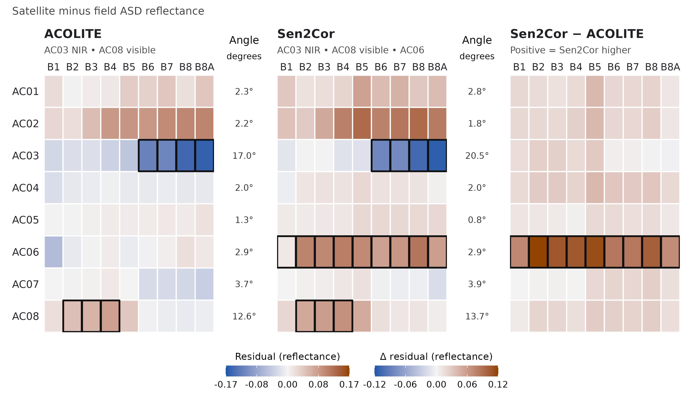
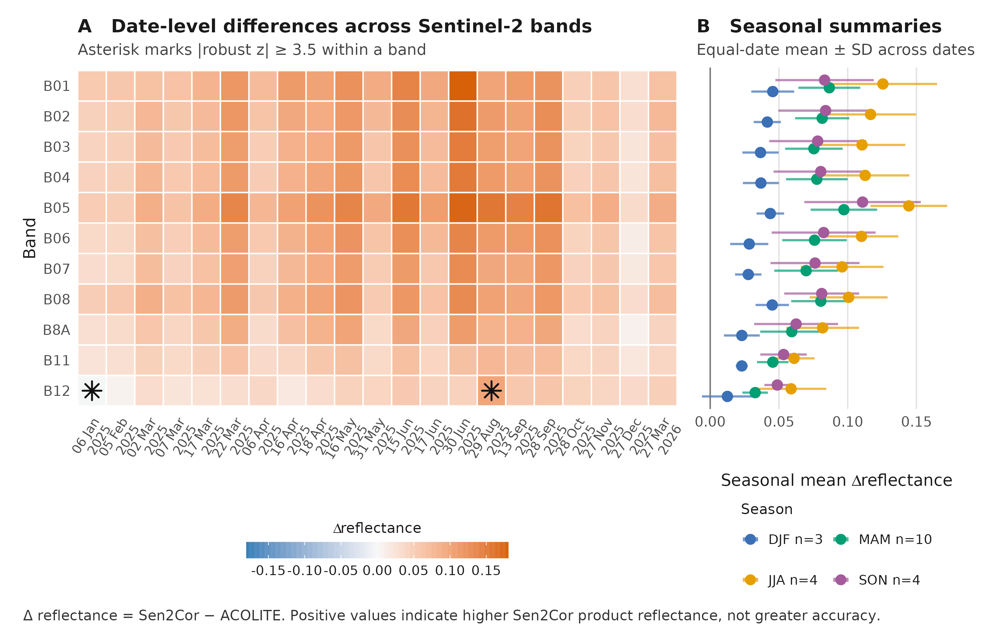
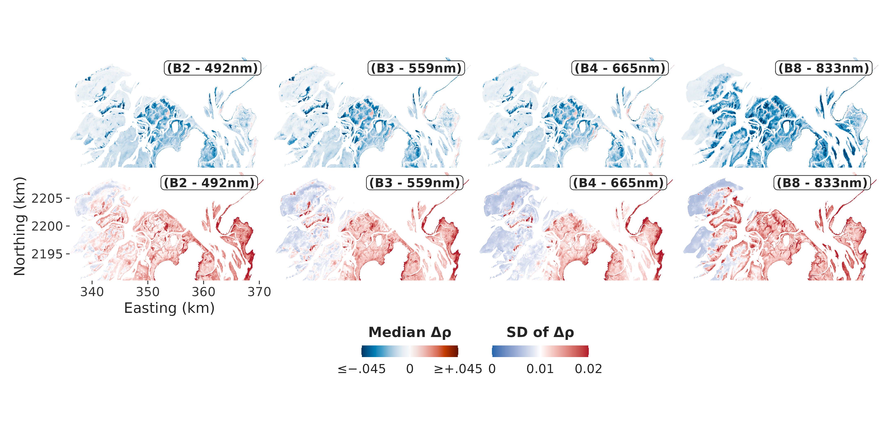

```{r reproducibility-setup}
#| include: false
set.seed(20261017)
```

<!--
MANUSCRIPT_SOURCE.qmd — authoritative scientific text (Hermione). Version: v15 (SCI-171, 2026-10-17). Scope per Board decision (SCI-151): eight-station field match-up of 27 March 2026 plus Sen2Cor–ACOLITE consistency across 2025–2026; ICE CREAMS adaptation and seagrass time-series reconstruction deferred to a follow-up. Replaces v14 (backup kept in the SCI-171 working folder).
Status: FINALIZED FOR INTEGRATION (v15), subject to Arthur's verbatim integration, Minerva's fidelity audit and my review of the rendered manuscript. Figure gate: Frida's revised eight-station figures (SCI-170) were inspected for scientific content and match the captions. Complete text for title, abstract, Introduction, Methods, Results, Discussion, Conclusions and captions. One passage remains explicitly PROVISIONAL (ACOLITE settings of the polygon analysis, Supplement).
Figure/table IDs (stable): fig-study-area, fig-field-spectra, fig-station-residuals, tbl-matchup-sensitivity, fig-temporal-consistency, fig-pixel-maps, fig-deltarho-maps (main); fig-pixel-spectra, fig-deltarho-seasonality, tbl-s2-surface (Supplement). Section IDs: sec-supp-methods, sec-supp-results.
Figure files (to be copied by Arthur into figures/): StudyArea_Fig001.png and FieldSpectra_Fig002.png, StationBandResidualHeatmap_FigXXX.png, TemporalProcessorDifferences_FigXXX.png, CorrectionDifferenceMaps_Fig005.png, DeltaRhoMedianSdMaps_Fig007_SCI146_v1.png, TargetSpectralSignatures_Fig006.png, DeltaRhoSeasonality_Fig008.png. The former matchup scatter plot and residual box plots (six-station) are retired from the manuscript.
Code note for Arthur (not text): tbl-s2-surface must use all eight stations (remove the six-station filter). Sign convention: the match-up, heat map and 2025–2026 AOI analysis use Sen2Cor minus ACOLITE; the maps and polygon analysis of the Supplement and Figs 5, 7, 8 use ACOLITE minus Sen2Cor. Both are defined in the text and captions.
Existing bibliography keys only; no new references.
-->

<!-- HERMIONE:BEGIN INTRODUCTION -->

# Introduction

Seagrasses form highly productive meadows in shallow coastal waters, and their habitat structure, sediment stabilisation and nutrient cycling support fisheries, shoreline protection and long-term carbon storage [@Orth2006Crisis; @Waycott2009Loss; @Nordlund2016SeagrassServices; @Fourqurean2012Carbon; @Unsworth2019Challenges]. A synthesis of 547 sites estimated a net loss of 19.1% of surveyed meadow area since 1884, with strong regional heterogeneity and recovery at some locations [@Dunic2021Declines]. Distinguishing recovery from continued degradation therefore depends on repeatable, spatially explicit observation [@Duffy2019Observing]. The Parc National du Banc d'Arguin (PNBA), Mauritania, holds one of the largest seagrass systems in Africa, estimated at about 772 km², of which about 353 km² is intertidal meadow dominated by *Zostera noltei* [@Wolff1993Banc; @Pottier2021Mapping]. Between surveys in 1986 and 2014 its seagrass cover roughly doubled while the benthic community changed markedly, so the meadow is a conservation asset whose trajectory requires reliable observation [@ElHacen2020LongTerm].

Observing the intertidal meadow from space requires surface reflectance that is consistent among dates. Each usable image captures a heterogeneous mosaic of seagrass, wet and dry sediment, tidal pools and adjacent bright desert surfaces [@Pottier2021Mapping], and any residual atmospheric effect can change the apparent brightness and shape of otherwise unchanged targets, producing offsets among dates that may be mistaken for habitat change [@Song2001Atmospheric; @Lyons2013TimeSeries; @Roelfsema2014Multitemporal]. Banc d'Arguin lies at the Sahara–Atlantic interface, where mineral dust is expected to vary seasonally in origin, altitude and particle size [@Knippertz2012Dust; @Senghor2017SeasonalCycle; @Friese2017Provenance], and thick, absorbing dust has been shown to defeat conventional atmospheric correction off western Africa [@Moulin2001Dust]. This is the motivation for the study, not one of its findings: we did not measure aerosol, and we do not test whether dust explains any result reported here.

Two processors are candidates for this task. Sen2Cor, the correction applied routinely by the European Space Agency to Sentinel-2 Level-2A products, estimates aerosol optical thickness preferentially over dense dark vegetation and relies on fallback values where such targets are absent [@MainKnorn2017Sen2Cor; @ESA2021Sen2CorATBD]. Whether suitable targets are representative in a hyper-arid landscape of bright surfaces and tidally changing flats cannot be assumed. ACOLITE with dark spectrum fitting was developed for aquatic applications and estimates the atmospheric path reflectance from the darkest targets in each image tile [@Vanhellemont2018Metre; @Vanhellemont2019DSF]; it is not designed for land surfaces and, as applied here, includes no adjacency or glint correction. Intercomparisons show that processor performance depends strongly on the environment [@Warren2019Assessment; @Bui2022Evaluation; @Doxani2023ACIX], yet to our knowledge neither processor has been evaluated against field reflectance on the exposed intertidal flats of Banc d'Arguin.

Evaluating the processors here faces two constraints. First, field reflectance is available for one date, so any match-up can show agreement on that date and cannot show consistency among dates. Second, for most dates there is no reference at all, so only the two processors can be compared with each other, which reveals the size and structure of their disagreement but not which of them is correct. We therefore combine the two kinds of evidence, using the field match-up as the only test of accuracy and the inter-processor comparison as a test of whether the disagreement is stable, varies seasonally or is concentrated in particular scenes and surfaces.

This study has three aims. First, to evaluate Sen2Cor and ACOLITE reflectance against ASD field spectra at eight stations spanning dry sand, mud, algal mud, white sand and seagrass on 27 March 2026, with explicit attention to how far the result depends on individual stations. Second, to examine the two stations at which both processors fail, using the history of their own pixels. Third, to quantify the persistence, seasonal structure and spatial pattern of the Sen2Cor–ACOLITE difference on 21 matched dates between January 2025 and March 2026. The adaptation of a habitat classifier to the preferred reflectance product and the reconstruction of a seagrass time series, which depend on the outcome of this evaluation, are left to follow-up work.

<!-- HERMIONE:END INTRODUCTION -->

<!-- HERMIONE:BEGIN METHODS -->

# Materials and Methods

## Study area and field reflectance measurements

The study was conducted in the PNBA, an extensive system of islands, shallow channels and intertidal flats on the Mauritanian coast [@Wolff1993Banc; @Pottier2021Mapping]. Fieldwork took place on 20–30 March 2026. Surface reflectance was measured with a portable ASD field spectroradiometer over 400–900 nm. On 27 March 2026, coincident with a Sentinel-2B overpass, eight stations (AC01–AC08) were sampled at two sites about 22 km apart (@fig-study-area): two on dry coastal sand (AC01–AC02), two on microphytobenthos mud (AC03–AC04), one on algal mud (AC05), one on white sand (AC06) and two on *Zostera noltei* seagrass (AC07–AC08). At each station, spectra were recorded within an area of about one 10 m Sentinel-2 pixel (five sets of 20 spectra), and the average spectrum of the station was used as the field reference. The acquisition time of the spectra and the tide height at each station were not available, and no within-station variability was used, so the uncertainty of the reference is not quantified.

```{r}
#| label: fig-study-area
#| fig-cap: "Study area and field stations in Banc d'Arguin, Mauritania. (A) Location on the West African coast. (B) The intertidal area (translucent mask) with the nearshore group (AC01–AC02) and the offshore group (AC03–AC08), about 22 km apart; the labels in this panel aggregate stations that overlap at this scale. (C, D) Enlarged views of the nearshore and offshore groups, with every station labelled and each with its own 500 m scale bar; the main-panel scale bar is 10 km. Station colours follow the surface classes of the field-spectra figure. The imagery shows general surface context and not conditions at the time of sampling; the vertical brightness step in panel D is a seam between imagery tiles and not an ecological boundary. Background imagery: Esri World Imagery (Esri, Maxar, Earthstar Geographics and the GIS User Community); locator land: Natural Earth."
#| echo: false
#| out-width: "100%"
knitr::include_graphics("figures/StudyArea_Fig001.png")
```

Each station spectrum was convolved to the bands of the Sentinel-2B Multispectral Instrument (MSI) that lie within the ASD range (B1–B8A; nine bands) using the official spectral response functions $S_b(\lambda)$ (ESA technical note COPE-GSEG-EOPG-TN-15-0007, version 4.0):

$$
R_b = \frac{\sum_{\lambda} R(\lambda)\,S_b(\lambda)}{\sum_{\lambda} S_b(\lambda)},
$$

where $R(\lambda)$ is the field reflectance at 1 nm and the sums run over the wavelengths covered by the ASD (@fig-field-spectra). Weighting the response functions by the extraterrestrial solar spectrum [@Wehrli1985Extraterrestrial] changed the root-mean-square deviation (RMSD) of either processor by less than 0.0001 in a test on seven of the eight stations (AC03 omitted) and is not used further.

```{r}
#| label: fig-field-spectra
#| fig-cap: "Field reflectance of the eight validation stations. (A) Average ASD reflectance spectra, 400–900 nm. (B) The same spectra convolved to the nine Sentinel-2B MSI bands B1–B8A. Colour identifies the surface class: dry sand (AC01–AC02), microphytobenthos (MPB) mud (AC03–AC04), algal mud (AC05), white sand (AC06) and seagrass (AC07–AC08). The dashed line is AC03; all other stations are solid. The two panels have different vertical axes."
#| echo: false
#| out-width: "100%"
knitr::include_graphics("figures/FieldSpectra_Fig002.png")
```

## Satellite reflectance products

Two surface-reflectance products were derived for the Sentinel-2B acquisition of 27 March 2026 (sensed at 11:45:53 UTC; tile 28QCH; processing baseline 05.12; cloud cover 0.015% of the tile). The first was the operational Level-2A product generated with Sen2Cor [@MainKnorn2017Sen2Cor; @ESA2021Sen2CorATBD], in which digital numbers were converted to bottom-of-atmosphere reflectance as $(\mathrm{DN} - 1000)/10{,}000$. Bands were used on their native grids (10 m: B2, B3, B4, B8; 20 m: B5, B6, B7, B8A; 60 m: B1). The second was obtained by processing the corresponding Level-1C product with ACOLITE using dark spectrum fitting [@Vanhellemont2019DSF; @Vanhellemont2018Metre]. Aerosol optical thickness was estimated in tiles of 600 × 600 pixels with minimum-DRMSD selection of the aerosol model and a three-pixel smoothing kernel. Surface reflectance ($\rho_s$) was produced at 10 m resolution, without adjacency or glint correction. ACOLITE bands were assigned to MSI bands according to the equivalent Sentinel-2B central wavelengths (maximum difference 0.34 nm). The two products do not have the same definition: Sen2Cor reflectance is a land-oriented bottom-of-atmosphere product, whereas ACOLITE reflectance is derived for aquatic targets and is applied here to land and intertidal surfaces as well, so differences between them are differences between processing chains and not only between aerosol retrievals. Aerosol optical thickness was not examined for 27 March.

## Match-up of field and satellite reflectance

Station coordinates were projected to the coordinate system of each raster, and satellite reflectance was extracted from the pixel containing each station. The match-up comprised 72 paired values per processor (eight stations × nine bands). With $F_i$ the convolved field reflectance, $S_i$ the satellite reflectance and $d_i = S_i - F_i$ the residual, agreement was quantified by the RMSD and the mean bias,

$$
\mathrm{RMSD}=\sqrt{\tfrac{1}{n}\sum_i d_i^2},\qquad
\mathrm{bias}=\tfrac{1}{n}\sum_i d_i ,
$$

computed over all paired values, by band, by station and by surface class. Spectral-shape agreement was measured for each station by the spectral angle between the nine-band satellite and field vectors. The difference between processors was expressed as $\Delta\mathrm{RMSD} = \mathrm{RMSD}_{\mathrm{Sen2Cor}} - \mathrm{RMSD}_{\mathrm{ACOLITE}}$, so that positive values indicate a lower RMSD for ACOLITE.

Because the nine bands of a station are not independent, uncertainty was estimated by a station-cluster percentile bootstrap [@Field2007Bootstrapping]: stations were resampled with replacement, all bands of a sampled station were kept together, and RMSD, bias and $\Delta$RMSD were computed on the same draws for both processors (10,000 draws; 2.5th and 97.5th percentiles). With eight clusters from two sites these intervals are unstable and probably too narrow; they describe station-to-station variability and are not a formal test.

The dependence of the result on individual stations was the main robustness analysis. $\Delta$RMSD was recomputed (with the same bootstrap) after omitting AC06, AC03, or both, and for all 28 pairs of omitted stations, and an exact two-sided binomial sign test was applied to the station-level RMSD differences, excluding ties. Because the two stations AC03 and AC08 stood out, and because AC06 is by far the brightest target, the residual was also regressed on field reflectance for each processor (pooled over bands, with and without AC06), and the paired difference in slopes between processors was bootstrapped over stations; these regressions are descriptive. The effect of extraction was assessed by sampling both products on a common 10 m grid (nearest-neighbour and bilinear) and by replacing the single pixel with the mean of 3 × 3 pixels (30 m). Coefficients of determination are reported in the Supplement but not used to rank the processors, because they follow the spectral contrast among surfaces and are insensitive to a constant offset.

## History of the two poorest stations

To place the satellite values at AC03 and AC08 in context, the reflectance of the archived Sen2Cor Level-2A scenes at the two station coordinates (156 scenes, 25 November 2015 to 25 February 2026; mixed processing baselines 05.00 to 05.12) was compiled for B3, B8A, B11 and B12. One scene with implausible values was excluded by a numerical screen (finite positive reflectance in the four bands and B8A ≥ 0.01), leaving 155 scenes, 18 of them in March. This is not a cloud, shadow, tide or atmospheric quality screen, because the archive has no such fields. The position of the 27 March B8A value of each processor and of the field value within the historical distribution was expressed as an empirical percentile. How the archive was extracted (pixel or window, registration) is not documented, and the history is Sen2Cor only, so the percentiles are context and not a validation, and the ACOLITE percentile is not like-for-like.

## Temporal consistency of the two processors, 2025–2026

To test whether the disagreement between processors is stable, the extraction of both products over two areas of interest at the Arel and Iwik sites (1,463 pixel positions: 730 and 733) was compared on every date for which both processors had been exported. Of 22 ACOLITE and 24 Sen2Cor exports, 21 dates (6 January 2025 to 27 March 2026) were shared and 1,463 coordinates matched exactly on each (30,723 pixel pairs per band). Three Sen2Cor-only dates (21 and 31 January and 20 February 2025) and one ACOLITE-only date (15 February 2025) were not used. Eleven common bands were compared (B1–B8, B8A, B11 and B12); B9 has no ACOLITE counterpart. No scene-classification screening was applied: all pixel positions were retained on every date, and the composition of the areas by surface class was not characterised. The difference was defined here as $D = \rho_\mathrm{Sen2Cor} - \rho_\mathrm{ACOLITE}$, the opposite sign to $\Delta\rho$ used in the Supplement, so that positive values indicate higher Sen2Cor reflectance.

For each date and band, the mean, median and standard deviation of $D$ over pixel pairs were calculated. Because every date contains the same number of pairs, the pooled and equal-date means coincide, and the equal-date mean is reported. Because adjacent pixels, bands and dates are not independent, pixel-pair counts and pixel-level proportions are descriptive and are not used for inference. Dates were grouped into meteorological seasons (DJF, MAM, JJA, SON), with equal weight per date. A date was flagged as an outlier within a band if the robust z-score of its mean, (date mean − median across dates) / (1.4826 × median absolute deviation), was at least 3.5 in absolute value. A linear trend of the date-level mean on elapsed time was fitted for each band as a diagnostic only, with nominal intervals, in view of the 21 irregularly spaced dates, the unbalanced seasonal sampling and the absence of covariates. The mean $D$ of the areas on 27 March 2026 was compared in sign and magnitude with the mean difference at the eight field stations. Calculations were performed in R.

## Spatial structure of the processor difference

The spatial pattern of the difference was examined on a single date (7 March 2026) and across 22 matched acquisitions within the intertidal polygon (6 January 2025 to 27 March 2026), using $\Delta\rho = \rho_\mathrm{ACOLITE} - \rho_\mathrm{Sen2Cor}$ resampled to the 10 m ACOLITE grid. The single-date comparison used no pixel mask. The multi-date comparison excluded pixels flagged by the Sen2Cor scene classification and summarised, for each pixel, the median and standard deviation of $\Delta\rho$ across dates for B2, B3, B4 and B8. Full methods, including the selection of 7 March, the target windows and the stripe and channel assessments, are given in the Supplementary Methods (@sec-supp-methods). All of these analyses are descriptive: they contain no reference measurement and cannot assess accuracy.

<!-- HERMIONE:END METHODS -->

<!-- HERMIONE:BEGIN RESULTS -->

# Results

## Agreement with field reflectance on 27 March 2026

Both processors reproduced the reflectance contrast among surfaces, and ACOLITE agreed more closely with the field reflectance (@tbl-matchup-sensitivity, @fig-station-residuals). Over the 72 station–band values, ACOLITE had an RMSD of 0.0500 (95% interval 0.0227–0.0698) and a mean bias of +0.0032 (−0.0258 to +0.0312), whereas Sen2Cor had an RMSD of 0.0659 (0.0402–0.0851) and a mean bias of +0.0309 (−0.0037 to +0.0635). The paired difference was $\Delta$RMSD = +0.0159 (+0.0018 to +0.0362). The bias intervals of both processors include zero, so the eight-station data do not establish that either is biased overall, and the intervals describe station-to-station variability and not a test of a difference. Spectral shape was preserved by both at six stations, with angles between satellite and field spectra below 4° (median over all stations 2.60° for ACOLITE and 2.83° for Sen2Cor); the exceptions were AC03 (17.0° and 20.5°) and AC08 (12.6° and 13.7°).

This advantage of ACOLITE was sensitive to one station and was not statistically secure (@tbl-matchup-sensitivity). Omitting the white-sand station AC06 halved $\Delta$RMSD from +0.0159 to +0.0079, with an interval that then included zero (−0.0006 to +0.0160). ACOLITE had the lower RMSD at six of eight stations (AC01, AC02, AC04, AC05, AC06, AC08), whereas Sen2Cor was lower at AC07 (0.0126 against 0.0219) and marginally at AC03 (0.0928 against 0.0968); the exact sign test gave p = 0.29, and p = 0.45 without AC06. The sign of $\Delta$RMSD never changed: it was positive when AC03 was omitted (+0.0222), when AC03 and AC06 were both omitted (+0.0124) and in all 28 omitted pairs (+0.0041 to +0.0253). It also persisted under every extraction variant (common 10 m grid with nearest-neighbour or bilinear sampling; 3 × 3 mean), with ACOLITE RMSD 0.0500–0.0525, Sen2Cor RMSD 0.0645–0.0680 and $\Delta$RMSD +0.0120 to +0.0180. The data therefore support a modest advantage of ACOLITE on this date, driven by AC06, and not a general ranking.

| Stations used | n stations | RMSD ACOLITE | RMSD Sen2Cor | $\Delta$RMSD (interval) | Stations favouring ACOLITE (sign-test p) |
|:---|:--:|:--:|:--:|:--:|:--:|
| All | 8 | 0.0500 | 0.0659 | +0.0159 (+0.0018 to +0.0362) | 6 of 8 (0.29) |
| Without AC06 | 7 | 0.0527 | 0.0606 | +0.0079 (−0.0006 to +0.0160) | 5 of 7 (0.45) |
| Without AC03 | 7 | 0.0389 | 0.0611 | +0.0222 (+0.0075 to +0.0434) | 6 of 7 (0.13) |
| Without AC03 and AC06 | 6 | 0.0410 | 0.0534 | +0.0124 (+0.0040 to +0.0174) | 5 of 6 (0.22) |

: Sensitivity of the difference in root-mean-square deviation ($\Delta$RMSD = RMSD of Sen2Cor − RMSD of ACOLITE; positive values favour ACOLITE) to the stations included, 27 March 2026. Intervals are 95% station-cluster bootstrap percentiles (10,000 draws) and are indicative only; with six to eight stations from two sites they are probably too narrow and are not significance tests. {#tbl-matchup-sensitivity}

The residuals showed where the processors differ (@fig-station-residuals). The excess of Sen2Cor over ACOLITE was positive at nearly every station and band, concentrated at the brightest surfaces. Over white sand (AC06), Sen2Cor had an RMSD of 0.0950 and a bias of +0.0900, against 0.0229 and −0.0044 for ACOLITE, and both processors were positively biased over dry sand (class RMSD 0.081 for Sen2Cor and 0.062 for ACOLITE; largest at AC02, bias +0.098 and +0.076). Regressing residuals on field reflectance, the Sen2Cor slope was +0.134 and the ACOLITE slope −0.032 (cluster intervals −0.250 to +0.241 and −0.284 to +0.108); without AC06 they became −0.028 and −0.072, and the paired slope difference fell from +0.166 (+0.012 to +0.207) to +0.044 (−0.002 to +0.080). Within AC06 the Sen2Cor residual was an approximately constant +0.08 to +0.12 in B2–B8A. The apparent brightness dependence is thus a leverage effect of one station, consistent with an additive offset, and does not establish a general dependence of the residual on brightness.

```{r}
#| label: fig-station-residuals
#| fig-cap: "Residuals of satellite reflectance relative to field reflectance at eight stations on 27 March 2026. Rows are stations (AC01–AC08) and columns are Sentinel-2B bands B1–B8A. The left and middle panels show residuals (satellite minus ASD reflectance) for ACOLITE and Sen2Cor; the right panel shows the difference between the residuals of the two processors (Sen2Cor minus ACOLITE), in which positive values mean a more positive Sen2Cor residual. The residual panels (±0.17) and the difference panel (±0.12) have separate colour scales, each symmetric about zero (blue negative, orange-brown positive). Black outlines mark three patterns discussed in the text as wholes: the near-infrared bands (B6–B8A) at AC03, the visible bands (B2–B4) at AC08, and all bands at AC06 (Sen2Cor and difference panels). The spectral angle (degrees) between satellite and field spectra is given beside each station for each processor. The figure describes one date and eight stations and does not identify the causes of the residuals."
#| echo: false
#| out-width: "100%"

```

Two stations were poorly matched by both processors, with different spectral signatures (@fig-station-residuals). At AC03 (microphytobenthos mud) the satellite reflectance was far below the field value in the red-edge and near-infrared bands for both processors (residual −0.115 to −0.163 in B6–B8A; satellite reflectance 0.092–0.141 against a field value of 0.252–0.256) while B1–B5 agreed moderately (|residual| ≤ 0.05). At AC08 (seagrass) the pattern was the reverse: the satellite reflectance exceeded the field value in the visible bands by a factor of about 1.7 to 2.7 (B2 0.097–0.118 against 0.046; B4 0.136–0.150 against 0.056), whereas B6–B8A agreed within 0.021 (0.235–0.266 against 0.239–0.251). AC03 is thus a near-infrared failure and AC08 a visible one, and AC07, the other seagrass station, was matched well (RMSD 0.013 by Sen2Cor and 0.022 by ACOLITE), so the seagrass class value (RMSD 0.040 for Sen2Cor and 0.033 for ACOLITE) averages two unlike stations. Class-level values are descriptive only, since each class comprises one or two stations (@tbl-s2-surface).

The historical record of the two stations clarifies one failure and not the other. At AC03 the satellite B8A of 27 March (0.092 for Sen2Cor; 0.095 for ACOLITE) lay at the 11th percentile of the 155 valid historical Sen2Cor scenes (median 0.201; March median 0.234; 5th–95th percentiles 0.046–0.276), whereas the field value (0.255) was close to the upper-middle of the history (about the 82nd percentile). The satellite pixel was therefore unusually dark in the near-infrared on this date and the field value was not unusual, which makes an error in the field reference less likely than a satellite-side or surface-state explanation. This is a pattern and not a cause, and no tide, wetness or water-cover information was available to test it. At AC08 the Sen2Cor B8A of 27 March (0.256) was at the upper edge of the history (95th percentile, above all 18 earlier March scenes; ACOLITE 0.240, 87th percentile against a Sen2Cor distribution) and agreed with the field value (0.248), so the near-infrared is not the problem at this station, and the visible excess is unexplained. The history is Sen2Cor only, its processing baselines differ and its median at AC08 shifts from 0.196 before 2023 to 0.219 afterwards, so these percentiles are context and not validation.

## Persistence and seasonal structure of the processor difference, 2025–2026

Across the 21 dates, Sen2Cor reflectance exceeded ACOLITE reflectance in every common band, and this sign does not show which processor is closer to the true reflectance (@fig-temporal-consistency). The equal-date mean difference $D$ ranged from +0.0379 in B12 to +0.1012 in B5 (+0.0875 in B1, +0.0771 in B3, +0.0790 in B4, +0.0794 in B8, +0.0590 in B8A and +0.0467 in B11), with pooled root-mean-square differences of 0.0435 (B12) to 0.1166 (B5). The mean difference was positive on every date in B1–B11, and in B12 on every date except 6 January 2025 (−0.0018). The offset is therefore persistent in sign and large relative to the RMSD of either processor against the field reference (0.050 and 0.066), although the areas compared are not the field stations and were not screened by surface class or scene classification. On 27 March 2026 the mean difference of the areas (+0.0381 to +0.0865) lay within the range of the 21 dates and had the same sign as at the eight stations, where it was smaller (+0.0179 to +0.0407 in B1–B8A); the means exceeded the medians (for example B1, 0.063 against 0.034), which indicates a right-skewed difference concentrated in a subset of pixels.

The magnitude of the difference varied among dates in a seasonally structured way (@fig-temporal-consistency). Equal-date seasonal means were lowest in DJF and highest in JJA in every band, for example +0.0455 against +0.1256 in B1, +0.0437 against +0.1445 in B5, +0.0230 against +0.0818 in B8A and +0.0125 against +0.0588 in B12. This pattern cannot be attributed to season as a cause. The three DJF dates are non-contiguous (January and February 2025 and December 2025), the seasons contain 3, 10, 4 and 4 dates, year and season are partly confounded, and no aerosol, tide, wetness, sun-elevation or cloud information was available. The largest differences in B1–B8A occurred on 30 June 2025 and the smallest in B1–B11 on 27 December 2025; B11 and B12 peaked on 29 August 2025. Only two cells met the outlier rule, both in B12: 29 August 2025 (mean +0.0964; robust z +5.06) and 6 January 2025 (−0.0018; robust z −3.63). Because no scene screening was applied, these extrema may reflect haze, thin cloud or other scene conditions and were not checked against scene-level quality information.

The fitted linear trend was nominally distinguishable from zero in one band only. Ten of eleven slopes had nominal 95% intervals that included zero; for B12 the slope was +0.0346 per year (+0.0098 to +0.0594) and remained positive when both flagged dates were removed (+0.0238 per year; +0.0067 to +0.0408). With 21 irregular dates, unbalanced seasons, eleven band-wise tests (Bonferroni-adjusted p of about 0.10 for the nominal 0.0088) and no covariates, this is a descriptive signal to be re-examined with more dates and not evidence of drift in either processor.

```{r}
#| label: fig-temporal-consistency
#| fig-cap: "Difference between Sen2Cor and ACOLITE surface reflectance on 21 matched dates, 6 January 2025 to 27 March 2026. (A) Mean difference $D = \\rho_\\mathrm{Sen2Cor} - \\rho_\\mathrm{ACOLITE}$ (unitless reflectance) over 1,463 matched pixel positions at two sites, by date (columns) and Sentinel-2 band (rows B01–B12). Orange indicates higher Sen2Cor reflectance and blue higher ACOLITE reflectance; the colour scale is symmetric about zero (−0.18 to +0.18). Asterisks mark the two cells flagged as robust outliers within a band (B12 on 6 January and 29 August 2025; absolute robust z at least 3.5). (B) Equal-date seasonal mean of $D$ by band for DJF (3 dates), MAM (10), JJA (4) and SON (4); horizontal bars show ± 1 SD of the date-level means, a descriptive spread and not a confidence interval. The values are differences between products and not errors relative to a field reference, so a positive value does not mean that Sen2Cor is more accurate. Season is partly confounded with year, and no aerosol, tide, cloud or illumination information was available."
#| echo: false
#| out-width: "100%"

```

## Spatial structure of the processor difference

Two further analyses, described in the Supplement (@sec-supp-results), show that the disagreement is spatially organised and that its size depends on the surface. In an unmasked comparison of 7 March 2026, ACOLITE reflectance was lower than Sen2Cor reflectance over bright and sedimentary surfaces and over the open water of the east (mean $\Delta\rho$ −0.0103 to −0.0199 in B2–B8A), and higher over darker and vegetated targets in the visible bands (@fig-pixel-maps). Narrow channels between the intertidal flats and a set of stripes in the north showed differences of opposite sign to their surroundings, and the cause of neither could be established. Over the intertidal polygon, the median $\Delta\rho$ across 22 acquisitions was negative in 94–97% of pixels in B2, B3, B4 and B8 (spatial median −0.009 in the visible bands and −0.016 in B8), with a standard deviation among dates of 0.010–0.012 that was as large as the median offset in the visible bands (@fig-deltarho-maps). The sign agrees with $D$, but the magnitude within the polygon (0.009–0.016) is several times smaller than in the two areas of the temporal analysis (0.04–0.10), so the offset depends on which surfaces are sampled and no single value describes it.

```{r}
#| label: fig-pixel-maps
#| fig-cap: "Spatial distribution of the difference in surface reflectance between ACOLITE and Sen2Cor, $\\Delta\\rho = \\rho_\\mathrm{ACOLITE} - \\rho_\\mathrm{Sen2Cor}$ (unitless reflectance), for bands B1–B8A (band centre wavelengths in nm) of the Sentinel-2B scene of 7 March 2026. No pixel mask was applied: cloud, cirrus, cloud shadow, land, water and defective pixels are all shown, and only grid cells without data in either product are blank. All band panels have the same extent and share one diverging colour scale centred on zero: blue indicates lower and red higher ACOLITE reflectance, and values beyond ±0.10 are saturated. The target-location panel shows the six target points (T1–T6) with a north arrow and a 5 km scale bar. Coordinates are in km (WGS 84 / UTM zone 28N) and are given on the bottom-left map only."
#| echo: false
knitr::include_graphics("figures/CorrectionDifferenceMaps_Fig005.png")
```

```{r}
#| label: fig-deltarho-maps
#| fig-cap: "Across-date median and variability of the difference in surface reflectance between ACOLITE and Sen2Cor within the intertidal polygon. The top row shows the per-pixel median of $\\Delta\\rho = \\rho_\\mathrm{ACOLITE} - \\rho_\\mathrm{Sen2Cor}$ (unitless reflectance) over 22 matched acquisitions (6 January 2025 to 27 March 2026) for B2 (492 nm), B3 (559 nm), B4 (665 nm) and B8 (833 nm) of the Sentinel-2 MSI; blue indicates lower and red higher ACOLITE reflectance, and the scale is centred on zero and saturated at ±0.045. The bottom row shows the per-pixel sample standard deviation (SD) of $\\Delta\\rho$ across dates; it uses its own colour scale, in which blue denotes low and red high SD, not the sign of $\\Delta\\rho$. The SD scale runs from 0 (blue) through 0.01 (white) to 0.02 (red); SD values above 0.02 are shown at the maximum colour, and the lower end is clipped at 0 by definition. Pixels were included on a date only if they were inside the intertidal polygon and not flagged by the Sen2Cor scene classification; the number of valid dates ranged from 5 to 22 among pixels (21 or 22 for the middle 90%). Coordinates are in km (WGS 84 / UTM zone 28N). Both statistics are descriptive of the difference between processors and confound atmosphere, tide and exposure, sensor platform and illumination geometry."
#| echo: false
#| out-width: "100%"

```

<!-- HERMIONE:END RESULTS -->

<!-- HERMIONE:BEGIN DISCUSSION -->

# Discussion

## What the field match-up does and does not show

On the single date for which field reflectance exists, ACOLITE dark spectrum fitting reproduced the field spectra somewhat better than Sen2Cor (pooled RMSD 0.050 against 0.066), and both retained spectral shape at six of eight stations. The more informative finding is how little of this difference is secure. Half of the RMSD gap disappears without one bright white-sand station, the sign test over stations is indecisive, and the bias of neither processor differs from zero at the pooled level. Sen2Cor's excess over the field reflectance over white sand, with a nearly constant offset of about 0.09 across bands, is the clearest processor-specific contrast, and an additive offset of this kind is what a mis-estimated aerosol or path contribution, residual adjacency or a footprint mismatch with a very bright and uniform surface would each produce. The data cannot discriminate among these, and the ACOLITE advantage at AC06 may equally reflect a favourable cancellation at a surface for which dark-spectrum fitting is not designed. Nor should the regression slope be read as brightness dependence, since it largely vanished when AC06 was omitted. Taken together, eight stations on one date support the statement that neither processor performs worse than the other in an obvious way at this site, that ACOLITE is no worse and plausibly somewhat better on bright sand, and nothing stronger.

## Two distinct failures shared by both processors

The two poorest stations should not be pooled as a single "difficult surface" problem. At AC03 both processors underestimate the near-infrared reflectance by 0.12–0.16, and the satellite value lies at the 11th percentile of the pixel's own history while the field value is typical, which points away from the field reference and towards the state of the surface on the day. A thin water film or saturated sediment lowers near-infrared reflectance sharply relative to the visible, and the satellite spectrum at AC03, with near-infrared reflectance lower than visible reflectance, has that form; but tide height at the station was not available, so the tide-state explanation remains an untested hypothesis, as do labelling, registration and the timing of the field measurement relative to the overpass. At AC08, in contrast, the near-infrared agrees and the visible bands are about twice the field value. Residual aerosol or adjacency from bright surroundings, or a mixed pixel containing bright sediment within a sparse seagrass canopy that the 10 m pixel and the point-scale ASD sample differently, would all produce a visible-only excess, and the neighbouring seagrass station AC07 is matched well. That two processors with different aerosol retrievals produce nearly the same residual argues that the cause is not specific to either aerosol model, but both products could share an error for the same reason, such as the absence of adjacency correction in ACOLITE and the representativeness of the field sample. We regard both failures as unresolved. They indicate that match-up error at individual intertidal stations can exceed the difference between the processors, which limits what a small number of stations can say about either one.

## Persistent offset, varying magnitude

The inter-processor comparison adds a different kind of information. Sen2Cor reflectance exceeded ACOLITE reflectance on every date in B1–B11, by an amount that was lowest in the winter dates sampled and highest in the summer ones. A persistent sign means that the choice of processor shifts reflectance in a predictable direction; a magnitude that varies by a factor of about three to five between the lowest and highest season (for example +0.046 to +0.126 in B1) means that the shift is not a constant offset that could be calibrated away. For a time series, such a seasonally varying difference matters because it has the same form as the signal that a seasonal phenology analysis seeks to detect, and the processor choice could therefore alias into inferred seasonal change. This inference concerns the relative difference only. Nothing in these data shows which processor follows the true reflectance, and the field match-up of March, where ACOLITE was closer, cannot be extrapolated to the other twenty dates. In particular, the winter-to-summer contrast is consistent with the seasonal changes in dust origin and altitude described for this region [@Senghor2017SeasonalCycle; @Friese2017Provenance], but sun elevation, tide, surface wetness and the Sen2Cor aerosol fallback behave seasonally as well, and the sampling (three DJF dates, one year) cannot separate them. That the March 2026 difference at the field stations is smaller than in the areas, and that the means exceed the medians, shows in addition that the disagreement is concentrated in some surfaces and is larger over bright ones, which is also where the match-up shows the largest Sen2Cor residuals.

The spatial analyses lead to the same caution. The polygon over the intertidal flats showed a difference of the same sign but several times smaller than in the two areas, and its standard deviation among dates was as large as the median in the visible bands, whereas the single-date comparison showed structured features (channels, northern stripes) whose causes are unknown. We interpret these differences in magnitude as dependence on the sampled surfaces and on screening, because the two analyses differ in support (about two million screened pixels in the polygon against 1,463 unscreened positions) and the surface composition of the two areas was not characterised, but we did not test this. Reflectance over channels, over dark water and in the northern stripes should not be used quantitatively from either product.

## Limitations

The match-up rests on one date, eight stations and two sites, with one or two stations per surface class; the stations are not independent replicates and the cluster intervals are indicative only. The ASD spectra are campaign averages of unknown timing relative to the overpass, without within-station variance, so the reference uncertainty is unquantified, and the 10 m to 60 m pixels differ in footprint from the ASD field of view. ACOLITE and Sen2Cor reflectance are not the same product, and the ACOLITE run used no adjacency or glint correction. No aerosol retrieval, tide height or sun and view geometry was examined for any date, so the role of aerosol in any result remains an assumption from the literature. The temporal analysis used extraction areas without scene screening, one year of irregularly spaced dates, and no covariates, and its trend and seasonal results are descriptive. The history of AC03 and AC08 is Sen2Cor only and was extracted by a method that could not be verified as identical to the match-up. The numbers of matched dates differ between the area-based analysis (21) and the polygon analysis (22) because 7 March 2026 was processed in the raster collection used for the polygon analysis but is absent from the area-based exports; the 21 dates are a subset of the 22. The two analyses also differ in spatial support, masking and sign convention, so their magnitudes are not directly comparable.

## Implications and next steps

For a seagrass time series based on either product, these results imply that processor choice is a time-dependent source of uncertainty of order 0.01–0.10 in reflectance, large relative to the contrasts among intertidal surfaces in the visible bands, and that this uncertainty should be propagated or bounded before ecological change is inferred from reflectance alone. Resolving which product is preferable requires three kinds of data that are not available here: field reflectance on several dates, preferably over bright and spectrally stable targets and including AC03-like surfaces; acquisition times of the spectra and a tide model at the stations, which would directly test the tide-state hypothesis at AC03; and aerosol retrievals from each processor or from an independent source for every date, which would test whether the seasonal pattern follows aerosol. Within-station variance of the five sets of 20 spectra, if the raw files can be supplied, would bound the reference uncertainty. The adaptation of a habitat classifier to the preferred reflectance product, and the reconstruction of a seagrass time series, should follow these steps and are not undertaken here.

<!-- HERMIONE:END DISCUSSION -->

<!-- HERMIONE:BEGIN CONCLUSIONS -->

# Conclusions

Against field reflectance on 27 March 2026, ACOLITE had the lower pooled RMSD (0.050 against 0.066), but the advantage halved without one white-sand station, was positive at six of eight stations only, and rests on bias intervals that include zero; it is not evidence for a general ranking. The two poorest stations, a near-infrared failure at AC03 and a visible-band failure at AC08, were shared by both processors and remain unexplained. Across 21 dates in 2025–2026, Sen2Cor reflectance exceeded ACOLITE reflectance in all common bands by an amount that varied seasonally, so processor choice is a time-dependent source of reflectance uncertainty whose direction relative to the truth cannot be determined from these data. Multi-date field reflectance, station-level tide and aerosol information are required before either processor can be recommended for seagrass time-series analysis at Banc d'Arguin.

<!-- HERMIONE:END CONCLUSIONS -->

---

<!-- HERMIONE:BEGIN SUPPLEMENT -->

# Supplementary material

## Supplementary Methods {#sec-supp-methods}

Methods of the spatial analyses summarised in the main text. These analyses compare the two processors with each other and contain no field reference.

### Pixel-wise comparison of Sen2Cor and ACOLITE reflectance on 7 March 2026

To describe how the two processors differ across the landscape, independently of the field stations, the Sen2Cor and ACOLITE reflectance of the Sentinel-2B scene of 7 March 2026 were compared pixel by pixel for the nine bands B1–B8A, which span the spectral range of the field measurements. This date, rather than the date of the field campaign, was selected as a contrasting scene with more cirrus: thin cirrus covered 6.2% of the study area (a further 0.4% was cloud and 0.1% cloud shadow), and the Sen2Cor aerosol optical thickness was moderate and fairly uniform (0.27–0.34; median 0.31). The scene was selected after the comparison had been inspected for 27 March and is not a randomly drawn test case; no quantitative comparison of the two dates is presented. Because no field reflectance was collected on 7 March, this comparison is independent of the match-up and cannot be used to assess accuracy.

Comparisons were made on the 10 m ACOLITE grid of the study area (3,763 × 1,974 cells, WGS 84 / UTM zone 28N). Sen2Cor reflectance was resampled to this grid by bilinear interpolation from its native 10, 20 or 60 m resolution, after conversion of digital numbers to reflectance as described above. The difference was defined as $\Delta\rho = \rho_\mathrm{ACOLITE} - \rho_\mathrm{Sen2Cor}$, so that positive values indicate higher ACOLITE reflectance.

No pixel mask was applied. Cloud, cirrus, cloud shadow, defective pixels, land, water, the intertidal flats and negative reflectance values were all retained, and the Sen2Cor scene classification was not used to screen any pixel. The aim was to keep the artefacts of both processors visible rather than to compare them only where they are expected to perform well. Only grid cells with no data in either product (1.6% of the grid; the undeclared fill value of the ACOLITE files was treated as no data) were left blank. The scene-wide statistics therefore include land, deep water, cloud-affected pixels and surfaces for which ACOLITE's dark-spectrum fitting was not designed, and are descriptive only. For each band, $\Delta\rho$ was summarised by its mean, median and range. The maps show $\Delta\rho$ itself, not a relative difference, because relative differences are unstable where reflectance approaches zero, as it does over dark water; the colour scale was saturated at ±0.10 for display only.

The spatial patterns in the maps were assessed visually, and two features that recurred across bands were examined further. The first was the set of narrow channels that separate intertidal areas. No layer delineating these channels is available, so they were assessed visually only, and their $\Delta\rho$ was set against band means of two regions chosen by eye: the intertidal complex (eastings 345–364 km and northings below 2,203 km) and the open water at the eastern edge of the scene (eastings above 369 km). The second was the pattern of stripes in the northernmost part of the scene, for which the mean $\Delta\rho$ was calculated in 1 km wide bins of easting over the northernmost 3 km (300 rows) of the grid. Neither the regions nor the bins were defined independently of the maps, so the resulting values describe the patterns seen and are not tests.

Six points of interest (T1–T6) were used to illustrate paired spectral signatures. Their positions and surface classes were assigned beforehand by the authors and were not derived from the spectra shown: terrestrial soil (T1), water (T2), seagrass (T3), intertidal sediment (T4), underwater vegetation (T5) and underwater sand (T6). For each point, the 3 × 3 cells (30 × 30 m) of the 10 m ACOLITE grid centred on the cell containing it were averaged, without masking, and the window means of the two products were compared band by band. All windows contained nine cells with data in every band. The surface classes are assigned labels without field verification at the pixel scale, and the state of the tide at image acquisition is not available, so intertidal and submerged targets may have been emergent or exposed. Each class is represented by a single target, so the target comparisons are illustrative. No reference measurement is available for this comparison, which therefore describes differences between the two processors and does not assess the accuracy of either. Calculations were performed in Python 3.12 with NumPy 1.26 and GDAL 3.8. The Sen2Cor product corresponds to ESA processing baseline 05.12, and the ACOLITE product to a date-stamped clone of the processor (April 2026); the exact release identifiers are not embedded in the delivered files. Because bands B1 (60 m) and B5–B8A (20 m) were resampled to 10 m, neighbouring cells are not independent and the comparison combines native resolutions.

### Multi-date comparison of Sen2Cor and ACOLITE reflectance

To test whether the differences seen on single dates are persistent or vary through time, the pixel comparison was extended to every Sentinel-2 acquisition of tile 28QCH for which both products were available. ACOLITE products were paired with Sen2Cor Level-2A products only when platform (Sentinel-2A, 2B or 2C), acquisition date and tile were identical. Of 24 ACOLITE acquisitions, 22 had an exact platform, date and tile match and were analysed (6 January 2025 to 27 March 2026); 15 February 2025 had no Sen2Cor product, and for 13 October 2025 only the adjacent tile 28QCG was available and was not substituted. Sen2Cor reflectance was calculated as $(\mathrm{DN} - 1000)/10{,}000$ for processing baselines 05.11 (2025) and 05.12 (2026) and resampled bilinearly to the 10 m ACOLITE grid, as for the single-date comparison, and $\Delta\rho = \rho_\mathrm{ACOLITE} - \rho_\mathrm{Sen2Cor}$ was computed for each date and band. <!-- PROVISIONAL: confirm with Luna that the ACOLITE settings for the 2025 acquisitions are those of 27 March 2026. -->

Unlike the single-date comparison, this analysis was restricted to the supplied intertidal polygon and to pixels that could be compared on every date. A pixel was retained for a given date if both reflectances were finite and the Sen2Cor scene classification did not flag it as no data, saturated or defective, cloud shadow, cloud (medium or high probability), thin cirrus or snow/ice (classes 0, 1, 3, 8, 9, 10 and 11); the undeclared ACOLITE fill value was treated as no data. No tide-height or date-specific exposure mask was available, so the polygon includes areas that were submerged on some dates and exposed on others. For each date and band, the spatial median and interquartile range (IQR) of $\Delta\rho$ were calculated over the retained pixels (about 2.1–2.4 million per date and band). For each pixel and band, the median and the sample standard deviation (SD) of $\Delta\rho$ across dates were also calculated, together with the number of dates with valid data. The median describes the persistent offset between processors and the SD its variability among dates; because the number of valid dates varies among pixels (5–22; 21 or 22 for the middle 90% of pixels), it is reported with both statistics.

Four bands were selected for presentation: B2 (492 nm, blue), B3 (559 nm, green), B4 (665 nm, red) and B8 (833 nm, near-infrared). B2–B4 span the visible range in which water-leaving and seagrass signals are expressed and in which the surface signal is expressed most strongly relative to the atmospheric contribution, and B8, a native 10 m band, is the band in which the processors differed most in the single-date comparison and in which the channel and flat patterns were clearest. The remaining bands (B1, B5–B7, B8A, B11 and B12) were processed identically and are not shown. The temporal pattern of $\Delta\rho$ was examined descriptively; with a single year of data, 22 irregularly spaced dates, and platform, atmosphere, tide and illumination confounded with date, no seasonal model was fitted and no significance test was applied. Calculations were performed in Python 3.12.3 with NumPy 1.26.4 and GDAL 3.8.4.

## Supplementary Results {#sec-supp-results}

Results of the spatial analyses summarised in the main text (@fig-pixel-maps and @fig-deltarho-maps are shown in the Results). Unlike the temporal analysis of the main text, these sections define $\Delta\rho = \rho_\mathrm{ACOLITE} - \rho_\mathrm{Sen2Cor}$.

<!-- HERMIONE:BEGIN SUPP-RESULTS-PIXEL -->

### Pixel-wise comparison of Sen2Cor and ACOLITE reflectance

Three features summarise the unmasked comparison of 7 March 2026 (@fig-pixel-maps, @fig-pixel-spectra). The difference between the processors was spatially organised rather than random. ACOLITE reflectance was lower than Sen2Cor reflectance over bright and sedimentary surfaces and over the open water of the east, and higher over dark and vegetated targets in the visible bands. Two structured features, the narrow channels between intertidal areas and a set of stripes in the north, showed differences of opposite sign to their surroundings, and the cause of neither could be determined from these data.

Over the 7.31 million grid cells with data in both products (98.4% of the grid), the mean $\Delta\rho$ decreased from +0.0012 in B1 to −0.0199 in B8 and was negative in B2–B8A (−0.0103 to −0.0199). Medians were closer to zero (+0.0039 in B1; −0.0051 to −0.0092 in B2–B8A), which indicates a tail of strongly negative values; individual values ranged from −0.186 (B2) to +0.156 (B3). The negative values were largest in the open water of the east and north-east, where they increased from the blue to the near-infrared bands (mean $\Delta\rho$ east of 369 km easting: −0.015 in B1, −0.037 in B3, −0.057 in B5 and −0.059 in B8). Over the intertidal complex the mean was smaller and also became more negative with wavelength (−0.005 in B1 to −0.028 in B8). These regional summaries were delimited by eye and are not stratified statistics.

The narrow channels that cut between the intertidal flats had a sign of $\Delta\rho$ opposite to that of the flats. The flats were mostly negative, whereas the channels appeared as thin, continuous lines of positive difference. The lines were faint in B1–B4 and conspicuous from B5 to B8A, and they were also present in B8, a native 10 m band, so resampling alone is unlikely to explain them. They were assessed visually, and their size was not quantified. We offer three untested explanations: Sen2Cor can return negative reflectance over dark water (as at target T2 below) where dark-spectrum fitting returns positive values; ACOLITE was run without adjacency correction and the channels are narrow and bordered by bright sediment; and suspended sediment, tide state or shallow bottom reflectance may be attributed differently to aerosol and surface by each processor. Distinguishing among them requires a delineated channel layer and the separate maps of each product. Until then, channel reflectance from either product should not be used quantitatively.

The northernmost part of every map contained vertical stripes of positive $\Delta\rho$. Two main stripes, each about 2 km wide and centred near 341 and 346 km easting, had a mean $\Delta\rho$ of +0.014 to +0.029 in B4, B5 and B8 over the northernmost 3 km, against −0.003 to −0.009 in the neighbouring bins (+0.017 to +0.024 in B1, against +0.003 to +0.005). The stripes were therefore of similar amplitude in all bands, an increase of roughly +0.015 to +0.035 relative to their surroundings, which suggests an additive offset unrelated to the surface. Their origin was not determined. Candidate explanations are aerosol estimates that vary at a scale of a few kilometres (although the ACOLITE tiles of 6 km are wider than the stripes), thin cirrus aligned with the satellite track (cirrus covered 6.2% of the scene and no mask was applied), and an artefact linked to the detector geometry of the MSI. Cells within the stripes should be treated as an atmospheric-correction artefact and not used for quantitative comparison between processors.

The six targets illustrate the same contrast (@fig-pixel-spectra). At the three targets over bright or sedimentary surfaces (T1, T4, T6), ACOLITE reflectance was lower than Sen2Cor reflectance in all nine bands and the spectra had similar shapes; the differences were largest over the terrestrial soil T1 (−0.043 in B1 to −0.084 in B5 and B8, or 10–22% of the Sen2Cor value), followed by the intertidal sediment T4 (−0.020 to −0.049) and the underwater sand T6 (−0.013 to −0.048). The sign was reversed at the three darker targets (T2, T3, T5), where ACOLITE was higher in the visible bands. Over water (T2), Sen2Cor reflectance was negative from B4 to B8A (−0.021 to −0.032), whereas ACOLITE reflectance was positive in all bands (0.017–0.079). At the seagrass target T3, ACOLITE was higher by 0.037–0.045 in B1–B4 and lower by 0.003–0.018 in B6–B8A, and both products showed the red-edge increase; its near-infrared reflectance of about 0.19 and the unknown tide state mean that T3 may have been emergent vegetation. At the darkest targets the difference between processors (up to 0.055) was of the same order as the reflectance itself. The positive difference at the water target T2 contrasts with the negative difference over the open water of the east, so disagreement over water was not uniform across the scene. Each class is a single target (nine cells) and no independent reference exists for this date, so these comparisons describe the disagreement between the processors and do not show which product is more accurate.

```{r}
#| label: fig-pixel-spectra
#| fig-cap: "Mean surface reflectance given by Sen2Cor (blue circles) and ACOLITE (orange triangles) in bands B1–B8A on 7 March 2026 for the 3 × 3-pixel windows centred on the six target points (T1–T6; locations in @fig-pixel-maps). No pixel mask was applied, and all windows contained nine pixels with data in every band. Panel titles give the target and its assigned surface class, and the small band labels within panels (B01, B04, B08) mark selected bands. The vertical axis differs among panels, and the dotted line marks zero reflectance."
#| echo: false
knitr::include_graphics("figures/TargetSpectralSignatures_Fig006.png")
```

<!-- HERMIONE:END SUPP-RESULTS-PIXEL -->

<!-- HERMIONE:BEGIN SUPP-RESULTS-MULTIDATE -->

### Persistence and variability of the processor difference across dates

Across 22 acquisitions, ACOLITE reflectance was lower than Sen2Cor reflectance over most of the intertidal area, and the offset was larger and more variable in the near-infrared than in the visible (@fig-deltarho-maps, @fig-deltarho-seasonality). The median $\Delta\rho$ was negative in 96.1% (B2), 93.6% (B3), 94.2% (B4) and 97.2% (B8) of pixels. Its spatial median was close to $-0.009$ in the visible bands (B2 −0.0093, B3 −0.0087, B4 −0.0088) and $-0.016$ in B8 (−0.0162). The offset was spatially structured: the most negative values (5th percentile of pixels: −0.029 to −0.031 in the visible bands and −0.039 in B8) occurred on the central and eastern flats and along the channel margins, and were most extensive in B8, whereas the north-western flats were close to zero. Pixels with positive median $\Delta\rho$ were a small minority and were most evident along the eastern margin in the visible bands. These maps describe the typical difference between processors for this site; the data contain no independent reference, and they do not show which product was closer to the true reflectance.

The variability of $\Delta\rho$ among dates was of the same order as its median offset. The per-pixel SD of $\Delta\rho$ had a spatial median of 0.0118 (B2), 0.0113 (B3), 0.0102 (B4) and 0.0124 (B8), and was as large as, or larger than, the median offset itself in the visible bands, so that in the visible bands the sign of $\Delta\rho$ at a given pixel was not reliably negative on every date. The SD was lowest on the north-western flats and highest on the eastern and south-eastern margins and in the central flats, and varied less among bands than the median did; between the 5th and 95th percentiles of pixels it ranged from 0.0085 to 0.0179 in B2 and from 0.0064 to 0.0189 in B8. Because the SD changed little with wavelength while the median offset was nearly twice as large in B8 as in the visible bands, the offset in the near-infrared was proportionally more persistent than that in the visible. Where valid dates were few, the median and SD rest on fewer observations (the minimum was 5 dates), but such pixels were rare. The areas of greatest SD coincide partly with those where the scene classification and tide state are most likely to change from date to date, which we did not test.

The temporal pattern was irregular rather than seasonal (@fig-deltarho-seasonality). The median of the per-date spatial medians was negative in every band (B2 −0.0109, B3 −0.0088, B4 −0.0092, B8 −0.0160). In B2, B3 and B4, $\Delta\rho$ was near zero or slightly positive on a few dates between April and June 2025 (B2 positive on four dates, B3 on four and B4 on three; maximum +0.0115 in B2 on 15 June 2025), and returned to −0.005 to −0.02 in the later part of 2025 and in 2026. In B8, the per-date median was negative on all 22 dates (−0.0434 to −0.0019), and was more negative on 29 August, 13 September and 28 September 2025 (−0.028, −0.033 and −0.028) than in April–June 2025 (−0.0039 to −0.0176). Because the record covers one year, these differences cannot be attributed to a seasonal cycle. Two features argue against interpreting them as seasonal. First, 22 March 2025 was a pronounced excursion in all four bands (per-date median −0.039 in B2, −0.036 in B3, −0.035 in B4 and −0.043 in B8), whereas the adjacent dates were much closer to zero (B8: −0.023 on 17 March and −0.008 on 6 April 2025); and second, B8 changed from −0.028 on 7 March 2026 to −0.002 on 27 March 2026, 20 days apart, whereas the same calendar date in 2025 gave −0.016. The spatial IQR of $\Delta\rho$ within a date (median 0.0132 in B2, 0.0139 in B3, 0.0116 in B4 and 0.0196 in B8; range 0.0040–0.0374 over bands and dates) was generally comparable to or larger than the change in the median between neighbouring dates, so that within a scene the processors differed more among pixels than the date-to-date shifts in their average.

```{r}
#| label: fig-deltarho-seasonality
#| fig-cap: "Temporal variation of the difference in surface reflectance between ACOLITE and Sen2Cor in the intertidal polygon. Points and lines show the spatial median of $\\Delta\\rho = \\rho_\\mathrm{ACOLITE} - \\rho_\\mathrm{Sen2Cor}$ (unitless reflectance) for each of 22 matched acquisitions (6 January 2025 to 27 March 2026) in B2 (blue), B3 (green), B4 (orange) and B8 (near-infrared, black). Shading is the interquartile range across pixels within each date, so it describes spatial spread within a scene and not uncertainty of the median. Lines connect consecutive dates without smoothing, and the dashed line marks zero. The record spans a single year with irregular spacing, and date is confounded with atmospheric state, tide and exposure, sensor platform and illumination geometry; the pattern is therefore not an estimate of seasonality."
#| echo: false
#| out-width: "100%"
knitr::include_graphics("figures/DeltaRhoSeasonality_Fig008.png")
```

Four explanations for the date-to-date variation are consistent with the data but were not tested. Atmospheric state, in particular aerosol load and dust events, which may affect the two aerosol-correction approaches differently, could produce the excursions (the 22 March 2025 anomaly is the clearest candidate, but no aerosol record was examined). The tide state at overpass changes the proportion of the polygon that is exposed, submerged or covered by thin water, which alters the target for which dark-spectrum fitting and Sen2Cor's land-based correction are each appropriate. Differences among Sentinel-2A, 2B and 2C in spectral response and calibration, and differences in sun and view geometry among dates, may contribute; the platform was not balanced across the record (11 acquisitions by 2B, 8 by 2C and 3 by 2A in the matched set), and median $\Delta\rho$ did not separate cleanly by platform in either B2 or B8, but 3 dates are too few to assess 2A. Finally, residual cirrus or cloud-edge pixels not removed by the scene classification would affect individual dates. Resolving among these explanations requires aerosol and tide records for each acquisition and a reference measurement on more than one date. Until then, the result supports only a limited conclusion: the two processors disagree by a small, mostly negative and date-variable offset over the intertidal flats, and a time series of reflectance from either product should be interpreted with the knowledge that the choice of processor alone changes reflectance by roughly 0.01 to 0.02 over these flats.

<!-- HERMIONE:END SUPP-RESULTS-MULTIDATE -->

## Supplementary table

```{r}
#| label: tbl-s2-surface
#| tbl-cap: "Descriptive agreement by surface class for the eight stations. Class-level values confound class with station and are not independent replication. Coefficients of determination for all eight stations (not used to rank the processors) were 0.84 for ACOLITE and 0.85 for Sen2Cor."
#| echo: false
s2_matchup <- readr::read_csv(
  "figures/sci24e_figure3_matchup_data.csv", show_col_types = FALSE
)
s2_surface <- s2_matchup |>
  dplyr::summarise(
    stations = dplyr::n_distinct(station),
    n = dplyr::n(),
    RMSD = sqrt(mean(residual^2)),
    Bias = mean(residual),
    MAE = mean(abs(residual)),
    .by = c(correction, target)
  ) |>
  dplyr::mutate(dplyr::across(c(RMSD, Bias, MAE), ~ sprintf("%.3f", .x))) |>
  dplyr::arrange(correction, target)
knitr::kable(s2_surface, align = c("l", "l", "r", "r", "r", "r", "r"))
```

<!-- HERMIONE:END SUPPLEMENT -->
