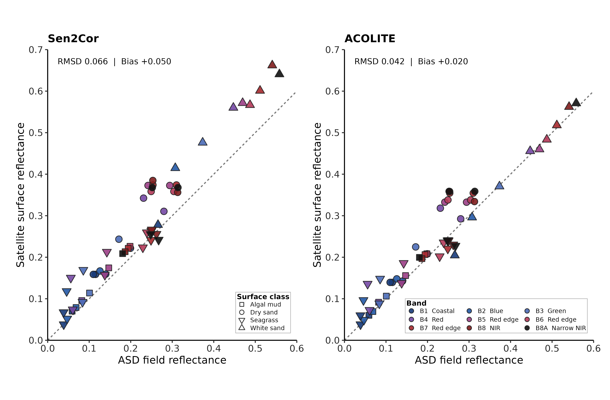
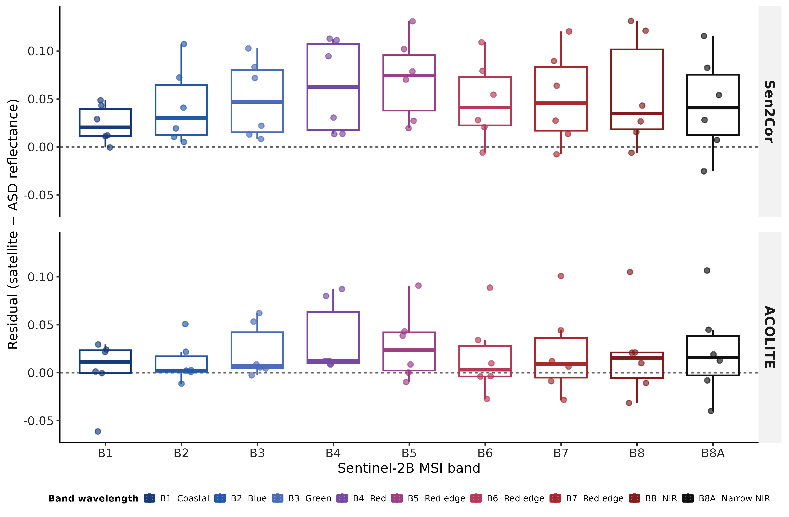
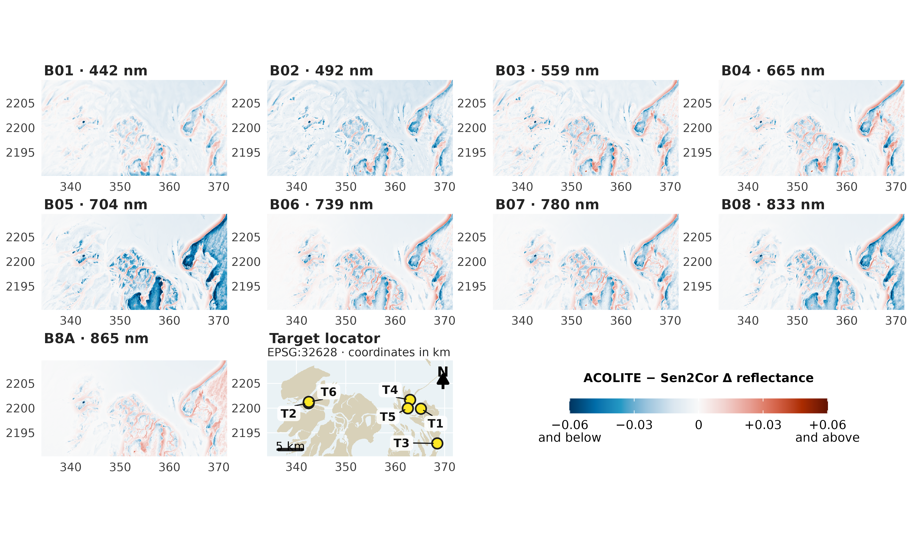

```{r reproducibility-setup}
#| include: false
set.seed(20261015)
```

# Alternative Title propositions :

- Mapping intertidal seagrass dynamics under Saharan dust: atmospheric correction and Sentinel-2 time-series analysis in Banc d’Arguin
- Spatiotemporal dynamics of intertidal seagrass in Banc d’Arguin, Mauritania from Sentinel-2 imagery: overcoming atmospheric-correction challenges under Saharan dust

# Introduction

Seagrasses are marine angiosperms that form highly productive meadows across shallow coastal waters [@Orth2006Crisis]. By creating three-dimensional habitat, attenuating waves, stabilising sediments and recycling nutrients, these foundation species support diverse assemblages of invertebrates, fishes, birds and marine megafauna [@Waycott2009Loss]. Their ecological functions translate into services that include nursery habitat and fisheries support, shoreline protection, water-quality regulation and long-term organic-carbon storage [@Barbier2011Value; @Nordlund2016SeagrassServices; @Fourqurean2012Carbon; @Unsworth2019Challenges]. Yet seagrass meadows are exposed to multiple, often interacting pressures, including coastal development, eutrophication, altered sediment regimes, destructive fishing and anchoring, and climate-driven warming and extreme events [@Orth2006Crisis; @Waycott2009Loss]. A synthesis of 547 sites estimated a net loss of 19.1% of the surveyed meadow area since 1884, while also revealing strong regional heterogeneity and recent recovery at some locations [@Dunic2021Declines]. This variability makes sustained, spatially explicit observation essential: global trends cannot substitute for local evidence, and recovery cannot be distinguished from continued degradation without repeatable measurements [@Duffy2019Observing].
The Parc National du Banc d’Arguin (PNBA), Mauritania, is an exceptional case. Located at the interface between the Sahara and the eastern boundary upwelling system of the North Atlantic, this approximately 12,000-km² protected seascape contains one of the largest remaining seagrass systems in Africa [@Wolff1993Banc; @Pottier2021Mapping]. A recent park-wide habitat map estimated about 772 km² of seagrass, comprising approximately 353 km² of intertidal meadow dominated by *Zostera noltei* and 419 km² of predominantly subtidal meadow dominated by *Cymodocea nodosa* [@Pottier2021Mapping]. These meadows sustain the benthic food web, provide habitat and nursery grounds for fishes and invertebrates, and underpin a site used by more than two million migratory waterbirds along the East Atlantic Flyway [@vanderHeide2012Symbiosis; @ElHacen2020LongTerm]. Their extent does not imply ecological stability: between spatially comprehensive surveys conducted in 1986 and 2014, seagrass cover increased approximately twofold while macrozoobenthic community composition and estimated secondary production changed markedly [@ElHacen2020LongTerm]. The Banc d’Arguin meadow is therefore both a globally important conservation asset and a dynamic ecosystem whose trajectories require reliable observation [@deFouw2016Drought; @ElHacen2020LongTerm].

The environmental setting of Banc d’Arguin is governed by the juxtaposition of a hyper-arid desert margin, broad shallow tidal flats and the wind-driven Mauritanian upwelling system [@Wolff1993Banc; @ould1993wind]. Freshwater input is negligible, precipitation is generally below 100 mm yr⁻¹, and persistent northerly winds help control waves, currents, sediment redistribution and exchanges between the bank and adjacent shelf [@Wolff1993Banc; @ould1993wind]. Wind forcing is strongly seasonal: mean speeds reported for the intertidal system rise to about 9 m s⁻¹ in May–June and decline to about 6 m s⁻¹ in November–December [@ould1993wind]. This annual cycle is embedded within the latitudinal migration of the Intertropical Convergence Zone, which reorganises both the origin and vertical pathway of mineral-dust transport over northwestern Africa [@Knippertz2012Dust]. During winter, dust reaching coastal Mauritania is transported mainly in low-level north-easterly trade winds from Western Saharan and regional sources; during summer, transport increasingly occurs within the elevated Saharan Air Layer and draws on sources in Mauritania, Mali and farther east [@Senghor2017SeasonalCycle; @Friese2017Provenance]. Superimposed on this seasonality are discrete dust outbreaks, including events that deliver anomalously coarse particles offshore [@Friese2016ParticleSize].
This aerosol regime creates a particular obstacle to optical monitoring of Banc d’Arguin, where low-tide habitat mapping depends on preserving the spectral consistency of exposed intertidal surfaces across acquisition dates [@Song2001Atmospheric]. Each usable acquisition captures a highly heterogeneous coastal mosaic comprising dense and sparse *Zostera noltei*, wet and dry sediment, tidal pools and adjacent bright desert surfaces [@Pottier2021Mapping]. Above this mosaic, mineral-dust abundance, particle-size distribution, source region and absorption properties vary seasonally and among individual outbreaks [@Kaufman2002Aerosols; @Knippertz2012Dust; @Friese2016ParticleSize]. These changes can alter the apparent brightness and spectral shape of otherwise unchanged intertidal targets, producing both spatial gradients within a scene and radiometric offsets among acquisition dates [@Song2001Atmospheric; @Doxani2023ACIX].
The difficulty is compounded by the way Sen2Cor, the atmospheric correction algorithm routinely applied on Sentinel-2 images by the European Space Agency, estimates aerosol optical thickness [@MainKnorn2017Sen2Cor]. The processor preferentially retrieves aerosol information over reference targets with known spectral behaviour, particularly dense dark vegetation, and uses fallback information or default values where suitable reference areas are unavailable [@ESA2021Sen2CorATBD; @MainKnorn2017Sen2Cor]. In the hyper-arid Banc d’Arguin landscape, dominated by bright desert surfaces and an intertidal zone that alternates among vegetation, moist sediment, bare sediment and shallow pools, the availability and representativeness of such reference targets cannot be assumed [@Wolff1993Banc; @Pottier2021Mapping]. An aerosol model adequate for one acquisition may consequently leave a different residual bias in another [@Doxani2023ACIX]. Thick, absorbing Saharan dust has already been shown to defeat conventional atmospheric correction off western Africa [@Moulin2001Dust], while comparative evaluations demonstrate that processor performance is strongly environment-dependent [@Warren2019Assessment; @Bui2022Evaluation; @Doxani2023ACIX]. For this study, the central requirement is therefore not merely to retrieve plausible reflectance for a single date, but to preserve the field-measured spectral relationships among exposed intertidal targets across acquisitions made under contrasting dust conditions [@Song2001Atmospheric; @Doxani2023ACIX].

Mapping exposed intertidal *Zostera noltei* requires stable spectral relationships among seagrass canopies, wet and dry sediment, macroalgae and residual tidal pools. Discrimination is particularly challenging where seagrasses and co-occurring green macroalgae, which share major photosynthetic pigments, produce partly overlapping multispectral signatures [@Davies2023Spectral]. Nevertheless, spectral-library experiments have shown that machine-learning classifiers can distinguish soft-bottom intertidal vegetation at Sentinel-2 spectral resolution, with little improvement obtained by increasing spectral resolution beyond approximately ten bands [@Davies2023Spectral]. Building on this foundation, Davies et al. developed the Intertidal Classification of Europe: Categorising Reflectance of Emerged Areas of Marine vegetation with Sentinel-2 (ICE CREAMS v1.0), a multiclass neural network trained with extensive drone-derived labels to identify seagrass and other exposed intertidal habitats [@Davies2024Phenology]. Independent validation across approximately 12,000 Sentinel-2 pixels yielded an overall accuracy of 0.82 for seagrass presence or absence, and subsequent applications resolved both seasonal phenology across 12 North-East Atlantic meadows and contrasting interannual trajectories at six European sites [@Davies2024Phenology; @Davies2024Trajectories]. These results establish ICE CREAMS as a scalable framework for intertidal seagrass monitoring, but transferring the classifier among dates and regions presupposes that the spectral relationships encoded by the model are preserved in the input imagery [@Davies2024Phenology; @Davies2024Trajectories; @Song2001Atmospheric]. Under the variable aerosol loads of Banc d’Arguin, incomplete correction can alter both the magnitude and shape of target spectra [@Song2001Atmospheric; @Doxani2023ACIX]. A classifier trained on one radiometric condition may then encounter another: unchanged seagrass can migrate in feature space, while atmospheric variability can be misinterpreted as habitat gain, loss or change in cover [@Song2001Atmospheric]. This problem is particularly consequential for time-series analysis, for which consistency among dates is at least as important as the accuracy of any single scene [@Lyons2013TimeSeries; @Roelfsema2014Multitemporal].
Sentinel-2 has already demonstrated the feasibility of mapping the PNBA’s coastal habitats, with a single-date supervised classification attaining more than 80% overall accuracy [@Pottier2021Mapping]. However, a static inventory cannot establish the timing, persistence or spatial pattern of ecological change [@Lyons2013TimeSeries; @Davies2024Trajectories]. Conversely, the pronounced differences observed between the 1986 and 2014 benthic surveys demonstrate the value of long-term comparison but do not resolve the intervening trajectory [@ElHacen2020LongTerm]. A radiometrically consistent satellite record could bridge these scales by tracking expansion, contraction and fragmentation at frequencies unattainable through field surveys alone [@Davies2024Phenology; @Davies2024Trajectories]. Without such a record, managers cannot confidently separate ecological change from retrieval artefacts, establish contemporary baselines, identify persistent hotspots of loss, evaluate conservation measures or target field surveillance [@Unsworth2019Challenges; @Duffy2019Observing]. More broadly, incomplete information on meadow status and condition remains a major barrier to seagrass conservation, and coordinated observing frameworks explicitly call for the integration of field measurements with repeated satellite mapping [@Unsworth2019Challenges; @Duffy2019Observing]. Resolving atmospheric-correction uncertainty is thus a prerequisite not only for classification accuracy, but also for defensible conservation assessments and policy decisions in the PNBA [@Song2001Atmospheric; @Doxani2023ACIX].

This study addresses that bottleneck by establishing a locally validated workflow for mapping the intertidal seagrass meadows of Banc d’Arguin through time. First, we use field hyperspectral measurements acquired over representative seagrass and non-seagrass targets to evaluate Sentinel-2 reflectance produced by Sen2Cor and two alternative atmospheric-correction approaches. The field spectra are matched to the Sentinel-2 spectral response, enabling us to assess both spectral fidelity and temporal consistency and to identify the correction best suited to this dust-influenced coastal environment. Second, we adapt the ICE CREAMS classification framework to the selected reflectance product, so that the habitat model operates on radiometrically coherent inputs rather than on correction-dependent spectral artefacts. Third, we apply the resulting workflow to the Sentinel-2 archive to reconstruct a time series of seagrass distribution and quantify the spatial and temporal dynamics of the intertidal meadow. The following sections describe the field campaign, satellite processing and atmospheric-correction comparison, the adapted classification workflow, and the procedures used to validate maps and derive change metrics.


<!--
MANUSCRIPT_SOURCE.qmd — authoritative scientific text (Hermione). Version: v5 (SCI-70, 2026-10-15).
Status: finalized for integration (v5, SCI-70, 2026-10-15). Six-station match-up and nine-band (B1–B8A) pixel comparison; numbers from the SCI-68 reruns. Not yet compiled or audited by Minerva.
Final figure files are those in figures/ (Fig001–Fig006).
Introduction is NOT part of this file and stays untouched in index.qmd.
Figure/table IDs (stable): fig-study-area, fig-field-spectra, fig-matchup, fig-residuals, fig-pixel-maps, fig-pixel-spectra, tbl-s2-surface. Integration note for Arthur (code, not text): the figure and Supplementary-table code must use only the six retained stations AC01, AC02 and AC05–AC08; the figure files are final and must not be regenerated with any other station set.
Existing bibliography keys only: Wolff1993Banc, Pottier2021Mapping, MainKnorn2017Sen2Cor, ESA2021Sen2CorATBD, Vanhellemont2019DSF, Vanhellemont2018Metre, Field2007Bootstrapping. No new references.
-->

<!-- HERMIONE:BEGIN METHODS -->

# Materials and Methods

## Study area and field reflectance measurements

The study was conducted in the Parc National du Banc d'Arguin (PNBA), north-western Mauritania, an extensive system of islands, shallow channels and intertidal flats at the interface between the Sahara and the eastern Atlantic [@Wolff1993Banc; @Pottier2021Mapping]. Fieldwork took place on 20–30 March 2026. Surface reflectance was measured with a portable ASD field spectroradiometer over 400–900 nm. On 27 March 2026, coincident with a Sentinel-2B overpass, six stations (AC01, AC02 and AC05–AC08) were sampled at two sites about 22 km apart (@fig-study-area): two on dry coastal sand (AC01–AC02), one on algal mud (AC05), one on white sand (AC06) and two on *Zostera noltei* seagrass (AC07–AC08). At each station, spectra were recorded within an area of about one 10 m Sentinel-2 pixel (five sets of 20 spectra), and the average spectrum of the station was used as the field reference.

```{r}
#| label: fig-study-area
#| fig-cap: "Study area and field stations. The main panel shows the intertidal area of Banc d'Arguin with the nearshore (AC01–AC02) and offshore (AC05–AC08) station groups; the inset locates the park on the West African coast. The two enlarged panels show the nearshore and offshore stations at a common scale. Station colours are used in all subsequent figures. Background imagery: Esri World Imagery; inset: OpenStreetMap contributors."
#| echo: false
#| out-width: "100%"
knitr::include_graphics("figures/StudyArea_Fig001.png")
```

Each station spectrum was convolved to the bands of the Sentinel-2B Multispectral Instrument (MSI) that lie within the ASD range (B1–B8A; nine bands) using the official spectral response functions $S_b(\lambda)$ (ESA technical note COPE-GSEG-EOPG-TN-15-0007, version 4.0):

$$
R_b = \frac{\sum_{\lambda} R(\lambda)\,S_b(\lambda)}{\sum_{\lambda} S_b(\lambda)},
$$

where $R(\lambda)$ is the field reflectance at 1 nm and the sums run over the wavelengths covered by the ASD (@fig-field-spectra). Weighting the response functions by the extraterrestrial solar spectrum [@Wehrli1985Extraterrestrial] changed the root-mean-square deviation (RMSD) of either processor by less than 0.0001 and is not used further.

```{r}
#| label: fig-field-spectra
#| fig-cap: "Field reflectance of the six validation stations. (A) Average ASD reflectance spectra, 400–900 nm. (B) The same spectra convolved to the nine Sentinel-2B MSI bands B1–B8A. Line colour identifies the surface class; the two spectra of each of the dry-sand and seagrass classes are from separate stations."
#| echo: false
#| out-width: "100%"
knitr::include_graphics("figures/FieldSpectra_Fig002.png")
```

## Satellite reflectance products

Two surface-reflectance products were derived for the Sentinel-2B acquisition of 27 March 2026 (sensed at 11:45:53 UTC; tile 28QCH; processing baseline 05.12; cloud cover 0.015% of the tile). The first was the operational Level-2A product generated with Sen2Cor [@MainKnorn2017Sen2Cor; @ESA2021Sen2CorATBD], in which digital numbers were converted to bottom-of-atmosphere reflectance as $(\mathrm{DN} - 1000)/10{,}000$. Bands were used on their native grids (10 m: B2, B3, B4, B8; 20 m: B5, B6, B7, B8A; 60 m: B1). The second was obtained by processing the corresponding Level-1C product with ACOLITE using dark spectrum fitting [@Vanhellemont2019DSF; @Vanhellemont2018Metre]. Aerosol optical thickness was estimated in tiles of 600 × 600 pixels with minimum-DRMSD selection of the aerosol model and a three-pixel smoothing kernel. Surface reflectance (`rhos`) was produced at 10 m resolution, without adjacency or glint correction. ACOLITE bands were assigned to MSI bands according to the equivalent Sentinel-2B central wavelengths (maximum difference 0.34 nm).

## Match-up of field and satellite reflectance

Station coordinates were projected to the coordinate system of each raster, and satellite reflectance was extracted from the pixel containing each station. The match-up comprised 54 paired values per processor (six stations × nine bands). With $F_i$ the convolved field reflectance, $S_i$ the satellite reflectance and $d_i = S_i - F_i$ the residual, agreement was quantified by the RMSD and the mean bias,

$$
\mathrm{RMSD}=\sqrt{\tfrac{1}{n}\sum_i d_i^2},\qquad
\mathrm{bias}=\tfrac{1}{n}\sum_i d_i ,
$$

computed over all paired values, by band, by station and by surface class. Spectral-shape agreement was measured for each station by the spectral angle between the nine-band satellite and field vectors. The difference between processors was expressed as $\Delta\mathrm{RMSD} = \mathrm{RMSD}_{\mathrm{Sen2Cor}} - \mathrm{RMSD}_{\mathrm{ACOLITE}}$, so that positive values indicate a lower RMSD for ACOLITE.

Because the nine bands of a station are not independent, uncertainty was estimated by a station-cluster percentile bootstrap [@Field2007Bootstrapping]: stations were resampled with replacement, all bands of a sampled station were kept together, and RMSD, bias and $\Delta$RMSD were computed on the same draws for both processors (10,000 draws). The 2.5th and 97.5th percentiles are reported as 95% intervals. With only six clusters these intervals are unstable and probably too narrow; they are given as a description of station-to-station variability and not as a formal test of a difference between processors. The influence of individual stations was assessed by recomputing $\Delta$RMSD after omitting each station in turn.

Two analytical choices were varied to test the robustness of the comparison: (i) extraction of both products on a common 10 m grid, using nearest-neighbour and bilinear sampling; and (ii) replacement of the single pixel by the mean of the 3 × 3 pixels (30 m) centred on each station. Coefficients of determination ($R^2$) were computed but are not used to rank the processors, because they mainly reflect the spectral contrast among surfaces and are insensitive to a constant offset.

## Pixel-wise comparison of Sen2Cor and ACOLITE reflectance

To describe how the two processors differ across the landscape, independently of the field stations, the Sen2Cor and ACOLITE reflectance of the 27 March 2026 scene were compared pixel by pixel for the nine bands B1–B8A, which span the spectral range of the field measurements. Comparisons were made on the 10 m ACOLITE grid of the study area (3,763 × 1,974 pixels, WGS 84 / UTM zone 28N). Sen2Cor reflectance was resampled to this grid by bilinear interpolation from its native 10, 20 or 60 m resolution, and the Sen2Cor scene classification layer (SCL) by nearest-neighbour assignment. Digital numbers were converted to reflectance as described above. The difference was defined as $\Delta\rho = \rho_\mathrm{ACOLITE} - \rho_\mathrm{Sen2Cor}$, so that positive values indicate higher ACOLITE reflectance.

Pixels were retained when the Sen2Cor digital number was positive, the ACOLITE value was valid, and the SCL class was not no-data, saturated or defective, cloud shadow, cloud, cirrus or snow/ice. Water, vegetation, bare-surface and other clear-sky classes were retained and no water-only mask was applied. Negative reflectance values were kept, because removing them would hide a feature of the products under comparison. For each band, the distribution of $\Delta\rho$ was summarised by its mean, median, standard deviation and percentiles, and by the proportion of pixels with $|\Delta\rho|$ above 0.01, 0.02, 0.05 and 0.10. To examine the spatial organisation of the differences, the most divergent 0.1% of pixels in each band (largest $|\Delta\rho|$) were assigned to mutually exclusive strata: the intertidal zone (a polygon layer delineating the intertidal flats), SCL water, SCL vegetation and SCL bare surfaces outside that polygon, and other pixels. The share of each stratum in the scene and the exceedance rate within each stratum were also computed, so that the composition of the extreme pixels could be read against the area covered by each stratum. Dependence of $\Delta\rho$ on surface brightness was examined by binning pixels according to Sen2Cor reflectance. As a check on resampling and edge effects, the analysis was repeated for the four native 10 m bands (B2, B3, B4 and B8) separately for SCL water and non-water pixels, after eroding the valid-pixel mask by one 10 m pixel.

Six 3 × 3-pixel windows (30 × 30 m) were selected to illustrate paired spectral signatures. They were chosen by fixed rules applied to the image: the window of minimum Sen2Cor near-infrared (B8) reflectance among SCL water pixels (T1); the window of maximum Sen2Cor red (B4) reflectance among SCL water pixels (T2); the windows of minimum B8 and of maximum B4 reflectance within the intertidal polygon (T3 and T4); the window of maximum Sen2Cor NDVI among SCL vegetation pixels (T5); and the window of maximum B4 reflectance among SCL bare-surface pixels (T6). The window means of ACOLITE and Sen2Cor reflectance were compared band by band. The targets are image-derived strata and carry no field-verified habitat labels. No reference measurement is available for this comparison, which therefore describes differences between the two processors and does not assess the accuracy of either. Calculations were performed in Python 3.12 with NumPy 1.26 and GDAL 3.8. The Sen2Cor product corresponds to ESA processing baseline 05.12, and the ACOLITE product to a date-stamped clone of the processor (April 2026); the exact release identifiers are not embedded in the delivered files. Because bands B1 (60 m) and B5–B8A (20 m) were resampled to 10 m, the comparison combines native resolutions.

<!-- HERMIONE:END METHODS -->

<!-- HERMIONE:BEGIN RESULTS -->

# Results

## Match-ups of atmospheric corrections

Both products reproduced the large reflectance contrast among surfaces (@fig-matchup), but ACOLITE was closer to the field reflectance. Over the 54 paired values, ACOLITE had an RMSD of 0.0417 (95% interval 0.0208–0.0618) and a mean bias of +0.0198 (−0.0005 to +0.0451), whereas Sen2Cor had an RMSD of 0.0656 (0.0345–0.0871) and a mean bias of +0.0499 (+0.0221 to +0.0778). The paired difference was $\Delta$RMSD = +0.0239 (+0.0086 to +0.0467). The processor intervals overlapped, and with six stations the data do not support a formal test of a difference. Coefficients of determination were high for both products (Sen2Cor 0.94, ACOLITE 0.92) and were higher for the processor with the larger error, because $R^2$ follows the spectral contrast among surfaces and ignores the positive offset.

```{r}
#| label: fig-matchup
#| fig-cap: "Field and satellite reflectance. ASD reflectance convolved to Sentinel-2B bands is plotted against satellite surface reflectance for Sen2Cor (left) and ACOLITE (right), for six stations and nine bands (54 values per panel). Point shape identifies the surface class and fill colour the band. The dashed line is the 1:1 line. RMSD and bias are given over all plotted values."
#| echo: false
#| out-width: "100%"

```

The difference between processors was expressed mainly as a bias. Sen2Cor reflectance was higher than the field reflectance in all nine bands (mean bias +0.024 in B1 to +0.071 in B5; band RMSD 0.030–0.081), whereas ACOLITE biases were smaller (+0.002 in B1 to +0.035 in B4; band RMSD 0.023–0.051) (@fig-residuals). ACOLITE had the lower RMSD at five of the six stations; Sen2Cor had the lower RMSD only at AC07 (0.0126 versus 0.0219). The contrast was concentrated at the brightest surface. Over white sand (AC06), Sen2Cor had an RMSD of 0.0950 and a bias of +0.0900, against 0.0229 and −0.0044 for ACOLITE; omitting AC06 reduced $\Delta$RMSD from +0.0239 to +0.0135, whereas omitting any other station gave +0.0248 to +0.0279. Both processors were positively biased over dry sand (Sen2Cor +0.072; ACOLITE +0.051), the largest bias at any station being at AC02 (+0.098 and +0.076, respectively). Over the two seagrass stations, RMSD was 0.0331 for ACOLITE and 0.0403 for Sen2Cor. At these stations the mean ACOLITE residual was positive in B1–B5 (+0.011 to +0.046) and negative in B6–B8A (−0.015 to −0.024), whereas the mean Sen2Cor residual was positive in B1–B5 (+0.014 to +0.054) and between −0.009 and +0.007 in B6–B8A. Values for each surface class are given in @tbl-s2-surface; each class is represented by one or two stations, so these values are descriptive. The causes of the positive bias were not tested. Adjacency from bright neighbouring surfaces, the tidal state and surface moisture at the time of the overpass, the difference between the ASD footprint and the 10–60 m pixels, and the resampled 60 m B1 band are plausible contributors.

```{r}
#| label: fig-residuals
#| fig-cap: "Residuals of satellite reflectance relative to field reflectance. Residuals (satellite minus ASD reflectance) are shown by Sentinel-2B band for Sen2Cor (top) and ACOLITE (bottom). Boxes show medians and interquartile ranges, whiskers extend to 1.5 times the interquartile range, and points are the individual station values. The dashed line marks zero residual."
#| echo: false
#| out-width: "100%"

```

Spectral shape was preserved at most stations. The median spectral angle between the satellite and field spectra was 2.59° for ACOLITE and 2.83° for Sen2Cor. Five stations had angles below 4° for both processors, whereas AC08 departed from this pattern (12.6° for ACOLITE; 13.7° for Sen2Cor): satellite reflectance in B3 was 0.148–0.169 against a field value of 0.086, while B8A agreed closely (0.240–0.256 against 0.248).

## Sensitivity of the match-up to analytical choices

Extraction on a common 10 m grid left the result for ACOLITE unchanged (RMSD 0.0417 with nearest-neighbour and bilinear sampling) and gave an RMSD for Sen2Cor of 0.0656 with nearest-neighbour and 0.0666 with bilinear sampling. Using the mean of 3 × 3 pixels gave an RMSD of 0.0423 for ACOLITE and 0.0649 (nearest neighbour) and 0.0622 (bilinear) for Sen2Cor. The sign of $\Delta$RMSD was positive in all variants (+0.0199 to +0.0249). These variants share the same six stations and therefore do not address the limited number of independent stations or the absence of an external validation data set.

<!-- HERMIONE:END RESULTS -->

<!-- HERMIONE:BEGIN RESULTS-PIXEL -->

## Pixel-wise comparison of Sen2Cor and ACOLITE reflectance

Approximately 7.31 million pixels per band were valid in both products. The scene-wide mean of $\Delta\rho$ was slightly negative in every band, from −0.0009 (B8A) to −0.0089 (B5), and its standard deviation ranged from 0.0072 (B1) to 0.0147 (B5). Absolute differences exceeded 0.01 in 14.8% (B8A) to 33.0% (B2) of pixels, exceeded 0.05 in 0.03% (B1) to 2.4% (B5) of pixels, and exceeded 0.10 in no more than 0.015% of pixels in any band. The small scene-wide means conceal marked spatial structure (@fig-pixel-maps). In all bands the differences were spatially coherent rather than random, and were organised along coastlines, tidal channels and the margins of the intertidal flats, where narrow bands of positive $\Delta\rho$ lay beside areas of negative $\Delta\rho$ in the visible and near-infrared bands. Negative differences of largest magnitude occurred over extensive areas in the south and east of the scene, most clearly in B5.

The composition of the largest differences reflected this pattern. In B1–B7, 69.2–91.9% of the most divergent 0.1% of pixels were SCL bare surfaces outside the intertidal polygon and 5.7–27.4% lay within it, although bare surfaces covered 16.2% of valid pixels, the intertidal polygon 33.1% and SCL water outside the polygon 50.7%. The within-stratum exceedance rate was accordingly 0.43–0.57% for bare surfaces and 0.005–0.083% for the water and intertidal strata. In B5, the mean $\Delta\rho$ was −0.029 over bare surfaces, −0.009 over the intertidal polygon and −0.002 over SCL water. The sign of the difference depended on surface brightness. In B4, the mean $\Delta\rho$ was +0.032 where Sen2Cor reflectance was negative, +0.012 where it was between 0 and 0.01, and −0.012 where it exceeded 0.4. The corresponding values in B8 were +0.019, +0.005 and −0.024. Sen2Cor produced negative reflectance in 0.001% (B3) to 0.86% (B6) of pixels, equivalent to 62,529 pixels in B6, whereas ACOLITE produced at most four negative pixels in any band. When the valid-pixel mask was eroded by one pixel, the mean $\Delta\rho$ of the four native 10 m bands remained negative for both SCL water (−0.0019 in B4 to −0.0069 in B2) and non-water pixels (−0.0060 in B3 and B4 to −0.0173 in B8).

The paired spectra of the six target windows are shown in @fig-pixel-spectra. Over the dark targets T1 (dark SCL water) and T3 (dark intertidal), ACOLITE reflectance exceeded Sen2Cor reflectance by 0.015–0.033 from B1 to B8A. Sen2Cor reflectance was negative at T1 in B4–B8A (down to −0.013 in B6) and at T3 in B6–B8A (down to −0.011 in B6), whereas ACOLITE reflectance was positive in all bands at both targets. Over the bright targets T2, T4 and T6, ACOLITE reflectance was lower than Sen2Cor reflectance in every band. The differences were largest in the red-edge and visible bands (T6, −0.153 in B5; T2, −0.121 in B2; T4, −0.086 in B5) and smallest in B1 for T4 (−0.008). The shapes of the two spectra were similar at these targets, with the same increase from blue to near-infrared. At the vegetation target T5, both products showed the red-edge increase and near-infrared plateau, with ACOLITE reflectance higher by 0.019–0.028 in B1–B4 and by 0.002–0.010 in B5–B8A (0.002 in B8). These comparisons describe the disagreement between the processors; because no independent reference is available at the pixel scale, they do not show which product is more accurate.

```{r}
#| label: fig-pixel-maps
#| fig-cap: "Spatial distribution of the difference in surface reflectance between ACOLITE and Sen2Cor ($\\Delta\\rho = \\rho_\\mathrm{ACOLITE} - \\rho_\\mathrm{Sen2Cor}$) for bands B1–B8A of the Sentinel-2B scene of 27 March 2026. All panels share one diverging colour scale centred on zero: blue indicates lower and red higher ACOLITE reflectance, and values beyond ±0.06 are saturated. Maps are displayed as 50 m block means of the 10 m differences. The last panel locates the six target windows (T1–T6) over the intertidal flats (beige); coordinates are in km (WGS 84 / UTM zone 28N)."
#| echo: false

```

```{r}
#| label: fig-pixel-spectra
#| fig-cap: "Mean surface reflectance given by Sen2Cor (blue circles) and ACOLITE (orange triangles) in bands B1–B8A for six 3 × 3-pixel target windows (T1–T6; locations in @fig-pixel-maps). Targets were selected from the image at extreme Sen2Cor values, as described in Methods. The vertical axis differs among panels, and the dotted line marks zero reflectance. *T2 is classified as water by the Sen2Cor scene classification but has high reflectance."
#| echo: false
knitr::include_graphics("figures/TargetSpectralSignatures_Fig006.png")
```

<!-- HERMIONE:END RESULTS-PIXEL -->

---

# Supplementary material

```{r}
#| label: tbl-s2-surface
#| tbl-cap: "Descriptive agreement by surface class for the six stations. Class-level values confound class with station and are not independent replication."
#| echo: false
s2_matchup <- readr::read_csv(
  "figures/sci24e_figure3_matchup_data.csv", show_col_types = FALSE
) |>
  dplyr::filter(station %in% c("AC01", "AC02", "AC05", "AC06", "AC07", "AC08"))
s2_surface <- s2_matchup |>
  dplyr::summarise(
    stations = dplyr::n_distinct(station),
    n = dplyr::n(),
    RMSD = sqrt(mean(residual^2)),
    Bias = mean(residual),
    MAE = mean(abs(residual)),
    .by = c(correction, target)
  ) |>
  dplyr::mutate(dplyr::across(c(RMSD, Bias, MAE), ~ sprintf("%.3f", .x))) |>
  dplyr::arrange(correction, target)
knitr::kable(s2_surface, align = c("l", "l", "r", "r", "r", "r", "r"))
```

```{r session-information}
#| include: false
sessionInfo()
```
