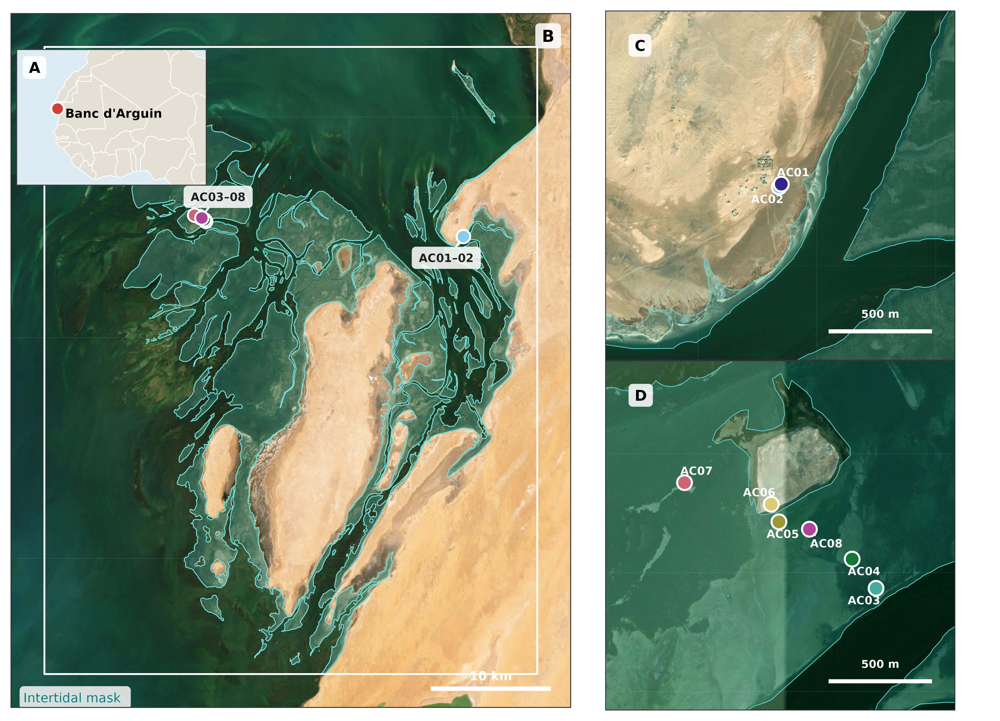
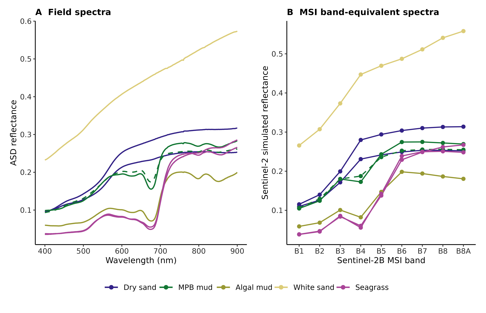
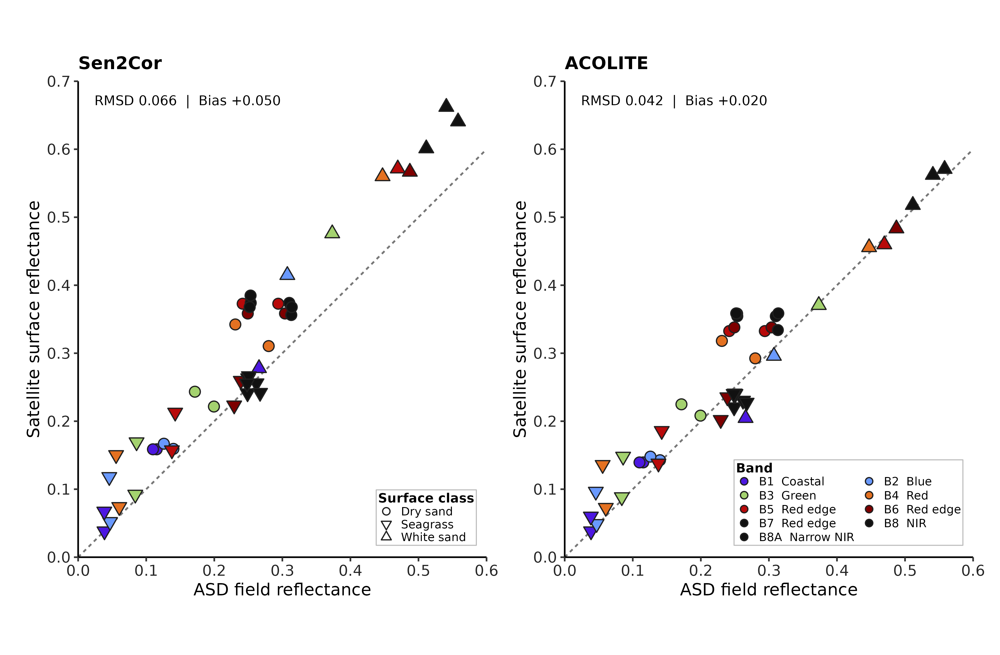
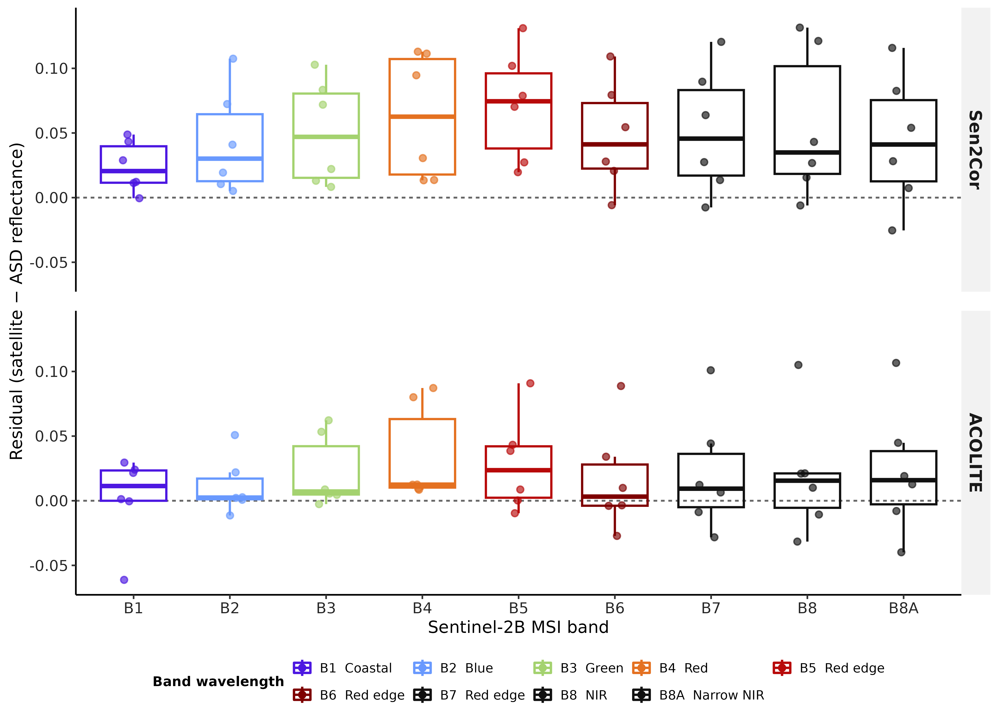
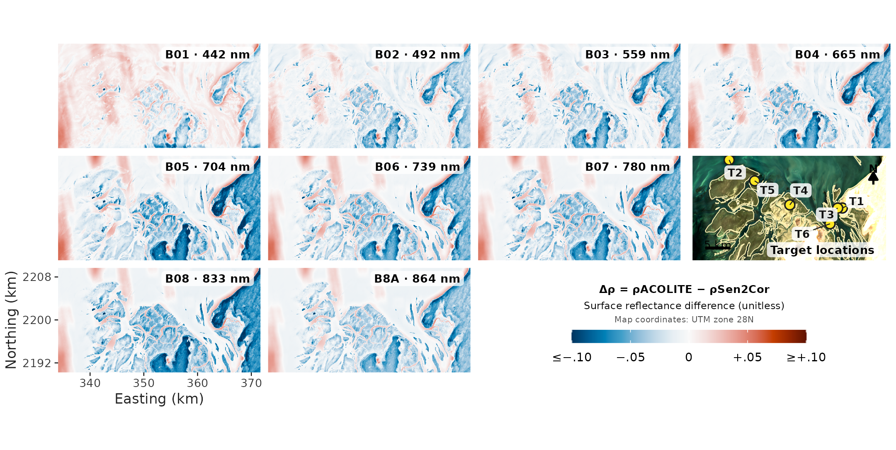
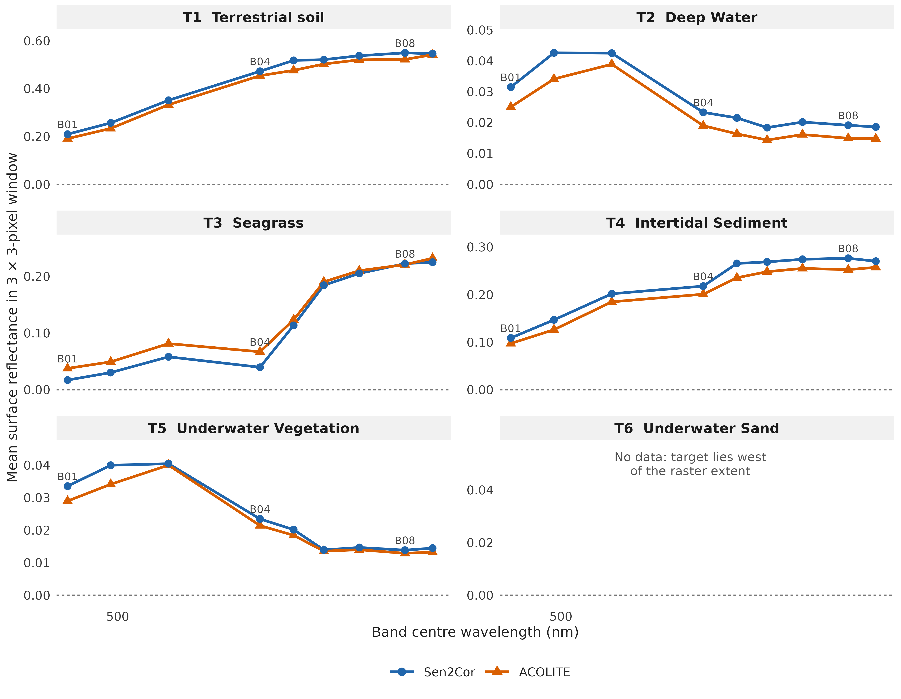
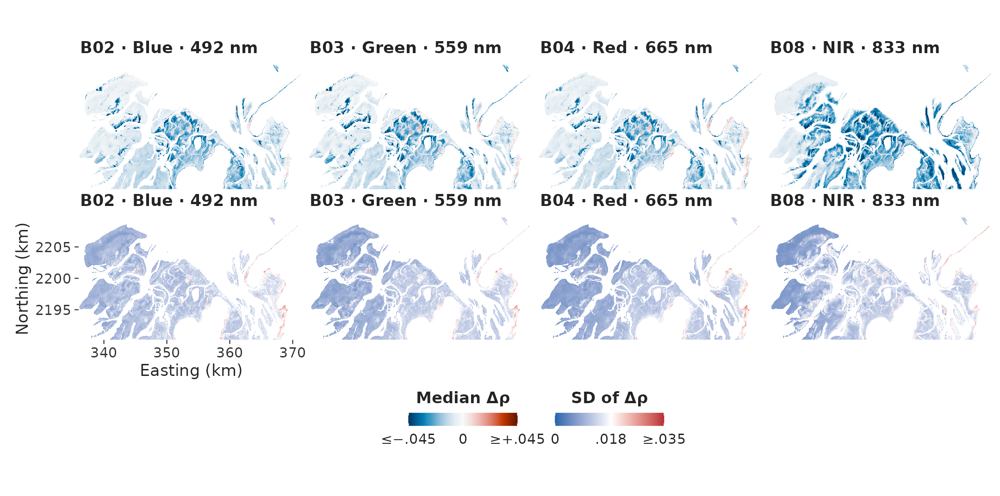
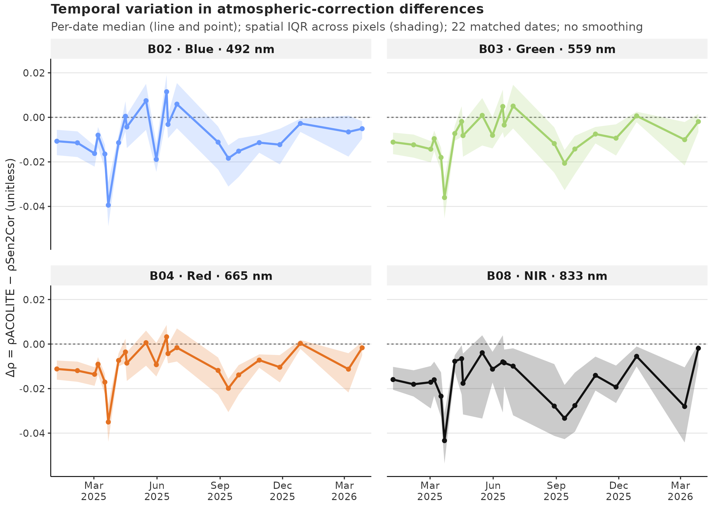

```{r reproducibility-setup}
#| include: false
set.seed(20261015)
```

# Alternative Title propositions :

- Mapping intertidal seagrass dynamics under Saharan dust: atmospheric correction and Sentinel-2 time-series analysis in Banc d’Arguin
- Spatiotemporal dynamics of intertidal seagrass in Banc d’Arguin, Mauritania from Sentinel-2 imagery: overcoming atmospheric-correction challenges under Saharan dust

# Introduction

Seagrasses are marine angiosperms that form highly productive meadows across shallow coastal waters [@Orth2006Crisis]. By creating three-dimensional habitat, attenuating waves, stabilising sediments and recycling nutrients, these foundation species support diverse assemblages of invertebrates, fishes, birds and marine megafauna [@Waycott2009Loss]. Their ecological functions translate into services that include nursery habitat and fisheries support, shoreline protection, water-quality regulation and long-term organic-carbon storage [@Barbier2011Value; @Nordlund2016SeagrassServices; @Fourqurean2012Carbon; @Unsworth2019Challenges]. Yet seagrass meadows are exposed to multiple, often interacting pressures, including coastal development, eutrophication, altered sediment regimes, destructive fishing and anchoring, and climate-driven warming and extreme events [@Orth2006Crisis; @Waycott2009Loss]. A synthesis of 547 sites estimated a net loss of 19.1% of the surveyed meadow area since 1884, while also revealing strong regional heterogeneity and recent recovery at some locations [@Dunic2021Declines]. This variability makes sustained, spatially explicit observation essential: global trends cannot substitute for local evidence, and recovery cannot be distinguished from continued degradation without repeatable measurements [@Duffy2019Observing].
The Parc National du Banc d’Arguin (PNBA), Mauritania, is an exceptional case. Located at the interface between the Sahara and the eastern boundary upwelling system of the North Atlantic, this approximately 12,000-km² protected seascape contains one of the largest remaining seagrass systems in Africa [@Wolff1993Banc; @Pottier2021Mapping]. A recent park-wide habitat map estimated about 772 km² of seagrass, comprising approximately 353 km² of intertidal meadow dominated by *Zostera noltei* and 419 km² of predominantly subtidal meadow dominated by *Cymodocea nodosa* [@Pottier2021Mapping]. These meadows sustain the benthic food web, provide habitat and nursery grounds for fishes and invertebrates, and underpin a site used by more than two million migratory waterbirds along the East Atlantic Flyway [@vanderHeide2012Symbiosis; @ElHacen2020LongTerm]. Their extent does not imply ecological stability: between spatially comprehensive surveys conducted in 1986 and 2014, seagrass cover increased approximately twofold while macrozoobenthic community composition and estimated secondary production changed markedly [@ElHacen2020LongTerm]. The Banc d’Arguin meadow is therefore both a globally important conservation asset and a dynamic ecosystem whose trajectories require reliable observation [@deFouw2016Drought; @ElHacen2020LongTerm].

The environmental setting of Banc d’Arguin is governed by the juxtaposition of a hyper-arid desert margin, broad shallow tidal flats and the wind-driven Mauritanian upwelling system [@Wolff1993Banc; @ould1993wind]. Freshwater input is negligible, precipitation is generally below 100 mm yr⁻¹, and persistent northerly winds help control waves, currents, sediment redistribution and exchanges between the bank and adjacent shelf [@Wolff1993Banc; @ould1993wind]. Wind forcing is strongly seasonal: mean speeds reported for the intertidal system rise to about 9 m s⁻¹ in May–June and decline to about 6 m s⁻¹ in November–December [@ould1993wind]. This annual cycle is embedded within the latitudinal migration of the Intertropical Convergence Zone, which reorganises both the origin and vertical pathway of mineral-dust transport over northwestern Africa [@Knippertz2012Dust]. During winter, dust reaching coastal Mauritania is transported mainly in low-level north-easterly trade winds from Western Saharan and regional sources; during summer, transport increasingly occurs within the elevated Saharan Air Layer and draws on sources in Mauritania, Mali and farther east [@Senghor2017SeasonalCycle; @Friese2017Provenance]. Superimposed on this seasonality are discrete dust outbreaks, including events that deliver anomalously coarse particles offshore [@Friese2016ParticleSize].
This aerosol regime creates a particular obstacle to optical monitoring of Banc d’Arguin, where low-tide habitat mapping depends on preserving the spectral consistency of exposed intertidal surfaces across acquisition dates [@Song2001Atmospheric]. Each usable acquisition captures a highly heterogeneous coastal mosaic comprising dense and sparse *Zostera noltei*, wet and dry sediment, tidal pools and adjacent bright desert surfaces [@Pottier2021Mapping]. Above this mosaic, mineral-dust abundance, particle-size distribution, source region and absorption properties vary seasonally and among individual outbreaks [@Kaufman2002Aerosols; @Knippertz2012Dust; @Friese2016ParticleSize]. These changes can alter the apparent brightness and spectral shape of otherwise unchanged intertidal targets, producing both spatial gradients within a scene and radiometric offsets among acquisition dates [@Song2001Atmospheric; @Doxani2023ACIX].
The difficulty is compounded by the way Sen2Cor, the atmospheric correction algorithm routinely applied on Sentinel-2 images by the European Space Agency, estimates aerosol optical thickness [@MainKnorn2017Sen2Cor]. The processor preferentially retrieves aerosol information over reference targets with known spectral behaviour, particularly dense dark vegetation, and uses fallback information or default values where suitable reference areas are unavailable [@ESA2021Sen2CorATBD; @MainKnorn2017Sen2Cor]. In the hyper-arid Banc d’Arguin landscape, dominated by bright desert surfaces and an intertidal zone that alternates among vegetation, moist sediment, bare sediment and shallow pools, the availability and representativeness of such reference targets cannot be assumed [@Wolff1993Banc; @Pottier2021Mapping]. An aerosol model adequate for one acquisition may consequently leave a different residual bias in another [@Doxani2023ACIX]. Thick, absorbing Saharan dust has already been shown to defeat conventional atmospheric correction off western Africa [@Moulin2001Dust], while comparative evaluations demonstrate that processor performance is strongly environment-dependent [@Warren2019Assessment; @Bui2022Evaluation; @Doxani2023ACIX]. For this study, the central requirement is therefore not merely to retrieve plausible reflectance for a single date, but to preserve the field-measured spectral relationships among exposed intertidal targets across acquisitions made under contrasting dust conditions [@Song2001Atmospheric; @Doxani2023ACIX].

Mapping exposed intertidal *Zostera noltei* requires stable spectral relationships among seagrass canopies, wet and dry sediment, macroalgae and residual tidal pools. Discrimination is particularly challenging where seagrasses and co-occurring green macroalgae, which share major photosynthetic pigments, produce partly overlapping multispectral signatures [@Davies2023Spectral]. Nevertheless, spectral-library experiments have shown that machine-learning classifiers can distinguish soft-bottom intertidal vegetation at Sentinel-2 spectral resolution, with little improvement obtained by increasing spectral resolution beyond approximately ten bands [@Davies2023Spectral]. Building on this foundation, Davies et al. developed the Intertidal Classification of Europe: Categorising Reflectance of Emerged Areas of Marine vegetation with Sentinel-2 (ICE CREAMS v1.0), a multiclass neural network trained with extensive drone-derived labels to identify seagrass and other exposed intertidal habitats [@Davies2024Phenology]. Independent validation across approximately 12,000 Sentinel-2 pixels yielded an overall accuracy of 0.82 for seagrass presence or absence, and subsequent applications resolved both seasonal phenology across 12 North-East Atlantic meadows and contrasting interannual trajectories at six European sites [@Davies2024Phenology; @Davies2024Trajectories]. These results establish ICE CREAMS as a scalable framework for intertidal seagrass monitoring, but transferring the classifier among dates and regions presupposes that the spectral relationships encoded by the model are preserved in the input imagery [@Davies2024Phenology; @Davies2024Trajectories; @Song2001Atmospheric]. Under the variable aerosol loads of Banc d’Arguin, incomplete correction can alter both the magnitude and shape of target spectra [@Song2001Atmospheric; @Doxani2023ACIX]. A classifier trained on one radiometric condition may then encounter another: unchanged seagrass can migrate in feature space, while atmospheric variability can be misinterpreted as habitat gain, loss or change in cover [@Song2001Atmospheric]. This problem is particularly consequential for time-series analysis, for which consistency among dates is at least as important as the accuracy of any single scene [@Lyons2013TimeSeries; @Roelfsema2014Multitemporal].
Sentinel-2 has already demonstrated the feasibility of mapping the PNBA’s coastal habitats, with a single-date supervised classification attaining more than 80% overall accuracy [@Pottier2021Mapping]. However, a static inventory cannot establish the timing, persistence or spatial pattern of ecological change [@Lyons2013TimeSeries; @Davies2024Trajectories]. Conversely, the pronounced differences observed between the 1986 and 2014 benthic surveys demonstrate the value of long-term comparison but do not resolve the intervening trajectory [@ElHacen2020LongTerm]. A radiometrically consistent satellite record could bridge these scales by tracking expansion, contraction and fragmentation at frequencies unattainable through field surveys alone [@Davies2024Phenology; @Davies2024Trajectories]. Without such a record, managers cannot confidently separate ecological change from retrieval artefacts, establish contemporary baselines, identify persistent hotspots of loss, evaluate conservation measures or target field surveillance [@Unsworth2019Challenges; @Duffy2019Observing]. More broadly, incomplete information on meadow status and condition remains a major barrier to seagrass conservation, and coordinated observing frameworks explicitly call for the integration of field measurements with repeated satellite mapping [@Unsworth2019Challenges; @Duffy2019Observing]. Resolving atmospheric-correction uncertainty is thus a prerequisite not only for classification accuracy, but also for defensible conservation assessments and policy decisions in the PNBA [@Song2001Atmospheric; @Doxani2023ACIX].

This study addresses that bottleneck by establishing a locally validated workflow for mapping the intertidal seagrass meadows of Banc d’Arguin through time. First, we use field hyperspectral measurements acquired over representative seagrass and non-seagrass targets to evaluate Sentinel-2 reflectance produced by Sen2Cor and two alternative atmospheric-correction approaches. The field spectra are matched to the Sentinel-2 spectral response, enabling us to assess both spectral fidelity and temporal consistency and to identify the correction best suited to this dust-influenced coastal environment. Second, we adapt the ICE CREAMS classification framework to the selected reflectance product, so that the habitat model operates on radiometrically coherent inputs rather than on correction-dependent spectral artefacts. Third, we apply the resulting workflow to the Sentinel-2 archive to reconstruct a time series of seagrass distribution and quantify the spatial and temporal dynamics of the intertidal meadow. The following sections describe the field campaign, satellite processing and atmospheric-correction comparison, the adapted classification workflow, and the procedures used to validate maps and derive change metrics.


<!--
MANUSCRIPT_SOURCE.qmd — authoritative scientific text (Hermione). Version: v11 (SCI-124, 2026-10-16; added multi-date Methods subsection and Results section for Figs 7–8; Figure/table IDs added: fig-deltarho-maps, fig-deltarho-seasonality; v10 (SCI-112, 2026-10-16; Results rewritten and condensed around Figs 3–6; v9 = pixel-wise Methods/Results and captions of Figs 5–6 rewritten for the unmasked extraction, edited target layer and rebuilt figures; v8 text of the masked analysis superseded).
Status: finalized for integration (v11, SCI-124, 2026-10-16; multi-date Methods subsection and Results section added; earlier text unchanged). Six-station match-up (27 March 2026, numbers from the SCI-68 reruns) and nine-band (B1–B8A) pixel comparison of 7 March 2026 (v9: numbers from the unmasked extraction of 16 October 2026 and Hermione's band-profile summaries of its rasters). Not yet compiled or audited by Minerva.
Final figure files are those in figures/ (Fig001–Fig006) plus DeltaRhoMedianSdMaps_Fig007.png and DeltaRhoSeasonality_Fig008.png (Frida's SCI-123 iteration-4 files, to be copied and renamed by Arthur).
Introduction is NOT part of this file and stays untouched in index.qmd.
Figure/table IDs (stable): fig-study-area, fig-field-spectra, fig-matchup, fig-residuals, fig-pixel-maps, fig-pixel-spectra, tbl-s2-surface. Integration note for Arthur (code, not text): the figure and Supplementary-table code must use only the six retained stations AC01, AC02 and AC05–AC08; the figure files are final and must not be regenerated with any other station set.
Existing bibliography keys only: Wolff1993Banc, Pottier2021Mapping, MainKnorn2017Sen2Cor, ESA2021Sen2CorATBD, Vanhellemont2019DSF, Vanhellemont2018Metre, Field2007Bootstrapping. No new references.
-->

<!-- HERMIONE:BEGIN METHODS -->

# Materials and Methods

## Study area and field reflectance measurements

The study was conducted in the Parc National du Banc d'Arguin (PNBA), north-western Mauritania, an extensive system of islands, shallow channels and intertidal flats at the interface between the Sahara and the eastern Atlantic [@Wolff1993Banc; @Pottier2021Mapping]. Fieldwork took place on 20–30 March 2026. Surface reflectance was measured with a portable ASD field spectroradiometer over 400–900 nm. On 27 March 2026, coincident with a Sentinel-2B overpass, six stations (AC01, AC02 and AC05–AC08) were sampled at two sites about 22 km apart (@fig-study-area): two on dry coastal sand (AC01–AC02), one on algal mud (AC05), one on white sand (AC06) and two on *Zostera noltei* seagrass (AC07–AC08). At each station, spectra were recorded within an area of about one 10 m Sentinel-2 pixel (five sets of 20 spectra), and the average spectrum of the station was used as the field reference.

```{r}
#| label: fig-study-area
#| fig-cap: "Study area and field stations. (A) Location of Banc d'Arguin on the West African coast. (B) The intertidal area of Banc d'Arguin with the nearshore (AC01–AC02) and offshore (AC05–AC08) station groups. (C, D) Enlarged views of the nearshore and offshore stations, each with its own scale bar. Stations AC03 and AC04, visible in D, were also sampled but are not part of the match-up analysis. Background imagery: Esri World Imagery; inset: OpenStreetMap contributors."
#| echo: false
#| out-width: "100%"

```

Each station spectrum was convolved to the bands of the Sentinel-2B Multispectral Instrument (MSI) that lie within the ASD range (B1–B8A; nine bands) using the official spectral response functions $S_b(\lambda)$ (ESA technical note COPE-GSEG-EOPG-TN-15-0007, version 4.0):

$$
R_b = \frac{\sum_{\lambda} R(\lambda)\,S_b(\lambda)}{\sum_{\lambda} S_b(\lambda)},
$$

where $R(\lambda)$ is the field reflectance at 1 nm and the sums run over the wavelengths covered by the ASD (@fig-field-spectra). Weighting the response functions by the extraterrestrial solar spectrum [@Wehrli1985Extraterrestrial] changed the root-mean-square deviation (RMSD) of either processor by less than 0.0001 and is not used further.

```{r}
#| label: fig-field-spectra
#| fig-cap: "Field reflectance of the six validation stations. (A) Average ASD reflectance spectra, 400–900 nm. (B) The same spectra convolved to the nine Sentinel-2B MSI bands B1–B8A. Line colour identifies the surface class (macroalgae: the algal-mud station AC05); the two spectra of each of the dry-sand and seagrass classes are from separate stations."
#| echo: false
#| out-width: "100%"

```

## Satellite reflectance products

Two surface-reflectance products were derived for the Sentinel-2B acquisition of 27 March 2026 (sensed at 11:45:53 UTC; tile 28QCH; processing baseline 05.12; cloud cover 0.015% of the tile). The first was the operational Level-2A product generated with Sen2Cor [@MainKnorn2017Sen2Cor; @ESA2021Sen2CorATBD], in which digital numbers were converted to bottom-of-atmosphere reflectance as $(\mathrm{DN} - 1000)/10{,}000$. Bands were used on their native grids (10 m: B2, B3, B4, B8; 20 m: B5, B6, B7, B8A; 60 m: B1). The second was obtained by processing the corresponding Level-1C product with ACOLITE using dark spectrum fitting [@Vanhellemont2019DSF; @Vanhellemont2018Metre]. Aerosol optical thickness was estimated in tiles of 600 × 600 pixels with minimum-DRMSD selection of the aerosol model and a three-pixel smoothing kernel. Surface reflectance (`rhos`) was produced at 10 m resolution, without adjacency or glint correction. ACOLITE bands were assigned to MSI bands according to the equivalent Sentinel-2B central wavelengths (maximum difference 0.34 nm). The pixel-wise comparison described below used the same two processing chains applied to the Sentinel-2B acquisition of 7 March 2026 (tile 28QCH, processing baseline 05.12). <!-- PROVISIONAL: the ACOLITE settings file for 7 March is not in the delivered folder; confirm with the Board/Luna that the 27 March configuration was used, or edit this sentence. -->

## Match-up of field and satellite reflectance

Station coordinates were projected to the coordinate system of each raster, and satellite reflectance was extracted from the pixel containing each station. The match-up comprised 54 paired values per processor (six stations × nine bands). With $F_i$ the convolved field reflectance, $S_i$ the satellite reflectance and $d_i = S_i - F_i$ the residual, agreement was quantified by the RMSD and the mean bias,

$$
\mathrm{RMSD}=\sqrt{\tfrac{1}{n}\sum_i d_i^2},\qquad
\mathrm{bias}=\tfrac{1}{n}\sum_i d_i ,
$$

computed over all paired values, by band, by station and by surface class. Spectral-shape agreement was measured for each station by the spectral angle between the nine-band satellite and field vectors. The difference between processors was expressed as $\Delta\mathrm{RMSD} = \mathrm{RMSD}_{\mathrm{Sen2Cor}} - \mathrm{RMSD}_{\mathrm{ACOLITE}}$, so that positive values indicate a lower RMSD for ACOLITE.

Because the nine bands of a station are not independent, uncertainty was estimated by a station-cluster percentile bootstrap [@Field2007Bootstrapping]: stations were resampled with replacement, all bands of a sampled station were kept together, and RMSD, bias and $\Delta$RMSD were computed on the same draws for both processors (10,000 draws). The 2.5th and 97.5th percentiles are reported as 95% intervals. With only six clusters these intervals are unstable and probably too narrow; they are given as a description of station-to-station variability and not as a formal test of a difference between processors. The influence of individual stations was assessed by recomputing $\Delta$RMSD after omitting each station in turn.

Two analytical choices were varied to test the robustness of the comparison: (i) extraction of both products on a common 10 m grid, using nearest-neighbour and bilinear sampling; and (ii) replacement of the single pixel by the mean of the 3 × 3 pixels (30 m) centred on each station. Coefficients of determination ($R^2$) were computed but are not used to rank the processors, because they mainly reflect the spectral contrast among surfaces and are insensitive to a constant offset.

## Pixel-wise comparison of Sen2Cor and ACOLITE reflectance

To describe how the two processors differ across the landscape, independently of the field stations, the Sen2Cor and ACOLITE reflectance of the Sentinel-2B scene of 7 March 2026 were compared pixel by pixel for the nine bands B1–B8A, which span the spectral range of the field measurements. This date, rather than the date of the field campaign, was selected as a contrasting scene with more cirrus: thin cirrus covered 6.2% of the study area (a further 0.4% was cloud and 0.1% cloud shadow), and the Sen2Cor aerosol optical thickness was moderate and fairly uniform (0.27–0.34; median 0.31). The scene was selected after the comparison had been inspected for 27 March and is not a randomly drawn test case; no quantitative comparison of the two dates is presented. Because no field reflectance was collected on 7 March, this comparison is independent of the match-up and cannot be used to assess accuracy.

Comparisons were made on the 10 m ACOLITE grid of the study area (3,763 × 1,974 cells, WGS 84 / UTM zone 28N). Sen2Cor reflectance was resampled to this grid by bilinear interpolation from its native 10, 20 or 60 m resolution, after conversion of digital numbers to reflectance as described above. The difference was defined as $\Delta\rho = \rho_\mathrm{ACOLITE} - \rho_\mathrm{Sen2Cor}$, so that positive values indicate higher ACOLITE reflectance.

No pixel mask was applied. Cloud, cirrus, cloud shadow, defective pixels, land, water, the intertidal flats and negative reflectance values were all retained, and the Sen2Cor scene classification was not used to screen any pixel. The aim was to keep the artefacts of both processors visible rather than to compare them only where they are expected to perform well. Only grid cells with no data in either product (1.6% of the grid; the undeclared fill value of the ACOLITE files was treated as no data) were left blank. The scene-wide statistics therefore include land, deep water, cloud-affected pixels and surfaces for which ACOLITE's dark-spectrum fitting was not designed, and are descriptive only. For each band, $\Delta\rho$ was summarised by its mean, median and range. The maps show $\Delta\rho$ itself, not a relative difference, because relative differences are unstable where reflectance approaches zero, as it does over dark water; the colour scale was saturated at ±0.10 for display only.

The spatial patterns in the maps were assessed visually, and two features that recurred across bands were examined further. The first was the set of narrow channels that separate intertidal areas. No layer delineating these channels is available, so they were assessed visually only, and their $\Delta\rho$ was set against band means of two regions chosen by eye: the intertidal complex (eastings 345–364 km and northings below 2,203 km) and the open water at the eastern edge of the scene (eastings above 369 km). The second was the pattern of stripes in the northernmost part of the scene, for which the mean $\Delta\rho$ was calculated in 1 km wide bins of easting over the northernmost 3 km (300 rows) of the grid. Neither the regions nor the bins were defined independently of the maps, so the resulting values describe the patterns seen and are not tests.

Six points of interest (T1–T6) were used to illustrate paired spectral signatures. Their positions and surface classes were assigned beforehand by the authors and were not derived from the spectra shown: terrestrial soil (T1), water (T2), seagrass (T3), intertidal sediment (T4), underwater vegetation (T5) and underwater sand (T6). For each point, the 3 × 3 cells (30 × 30 m) of the 10 m ACOLITE grid centred on the cell containing it were averaged, without masking, and the window means of the two products were compared band by band. All windows contained nine cells with data in every band. The surface classes are assigned labels without field verification at the pixel scale, and the state of the tide at image acquisition is not available, so intertidal and submerged targets may have been emergent or exposed. Each class is represented by a single target, so the target comparisons are illustrative. No reference measurement is available for this comparison, which therefore describes differences between the two processors and does not assess the accuracy of either. Calculations were performed in Python 3.12 with NumPy 1.26 and GDAL 3.8. The Sen2Cor product corresponds to ESA processing baseline 05.12, and the ACOLITE product to a date-stamped clone of the processor (April 2026); the exact release identifiers are not embedded in the delivered files. Because bands B1 (60 m) and B5–B8A (20 m) were resampled to 10 m, neighbouring cells are not independent and the comparison combines native resolutions.

## Multi-date comparison of Sen2Cor and ACOLITE reflectance

To test whether the differences seen on single dates are persistent or vary through time, the pixel comparison was extended to every Sentinel-2 acquisition of tile 28QCH for which both products were available. ACOLITE products were paired with Sen2Cor Level-2A products only when platform (Sentinel-2A, 2B or 2C), acquisition date and tile were identical. Of 24 ACOLITE acquisitions, 22 were matched (6 January 2025 to 27 March 2026); 15 February 2025 had no Sen2Cor product, and for 13 October 2025 only the adjacent tile 28QCG was available and was not substituted. Sen2Cor reflectance was calculated as $(\mathrm{DN} - 1000)/10{,}000$ for processing baselines 05.11 (2025) and 05.12 (2026) and resampled bilinearly to the 10 m ACOLITE grid, as for the single-date comparison, and $\Delta\rho = \rho_\mathrm{ACOLITE} - \rho_\mathrm{Sen2Cor}$ was computed for each date and band. <!-- PROVISIONAL: confirm with Luna that the ACOLITE settings for the 2025 acquisitions are those of 27 March 2026. -->

Unlike the single-date comparison, this analysis was restricted to the supplied intertidal polygon and to pixels that could be compared on every date. A pixel was retained for a given date if both reflectances were finite and the Sen2Cor scene classification did not flag it as no data, saturated or defective, cloud shadow, cloud (medium or high probability), thin cirrus or snow/ice (classes 0, 1, 3, 8, 9, 10 and 11); the undeclared ACOLITE fill value was treated as no data. No tide-height or date-specific exposure mask was available, so the polygon includes areas that were submerged on some dates and exposed on others. For each date and band, the spatial median and interquartile range (IQR) of $\Delta\rho$ were calculated over the retained pixels (about 2.1–2.4 million per date and band). For each pixel and band, the median and the sample standard deviation (SD) of $\Delta\rho$ across dates were also calculated, together with the number of dates with valid data. The median describes the persistent offset between processors and the SD its variability among dates; because the number of valid dates varies among pixels (5–22; 21 or 22 for the middle 90% of pixels), it is reported with both statistics.

Four bands were selected for presentation: B2 (492 nm, blue), B3 (559 nm, green), B4 (665 nm, red) and B8 (833 nm, near-infrared). B2–B4 span the visible range in which water-leaving and seagrass signals are expressed and in which the surface signal is expressed most strongly relative to the atmospheric contribution, and B8, a native 10 m band, is the band in which the processors differed most in the single-date comparison and in which the channel and flat patterns were clearest. The remaining bands (B1, B5–B7, B8A, B11 and B12) were processed identically and are not shown. The temporal pattern of $\Delta\rho$ was examined descriptively; with a single year of data, 22 irregularly spaced dates, and platform, atmosphere, tide and illumination confounded with date, no seasonal model was fitted and no significance test was applied. Calculations were performed in Python 3.12.3 with NumPy 1.26.4 and GDAL 3.8.4.

<!-- HERMIONE:END METHODS -->

<!-- HERMIONE:BEGIN RESULTS -->

# Results

## Match-ups of atmospheric corrections

Both processors reproduced the reflectance contrast among surfaces, but ACOLITE agreed more closely with the field reflectance (@fig-matchup). Over the 54 paired values, ACOLITE had an RMSD of 0.0417 (95% interval 0.0208–0.0618) and a mean bias of +0.0198 (−0.0005 to +0.0451), whereas Sen2Cor had an RMSD of 0.0656 (0.0345–0.0871) and a mean bias of +0.0499 (+0.0221 to +0.0778). The paired difference was $\Delta$RMSD = +0.0239 (+0.0086 to +0.0467). The intervals of the two processors overlap, and with six stations they describe station-to-station variability rather than provide a test of a difference. Coefficients of determination were high for both products and slightly higher for Sen2Cor (0.94) than for ACOLITE (0.92); $R^2$ follows the spectral contrast among surfaces and ignores the positive offset, so it does not rank the processors. Spectral shape was preserved by both: the median spectral angle between satellite and field spectra was 2.59° for ACOLITE and 2.83° for Sen2Cor, and five stations had angles below 4° for both. The exception was the seagrass station AC08 (12.6° for ACOLITE; 13.7° for Sen2Cor), where satellite reflectance in B3 (0.148–0.169) was well above the field value (0.086) while B8A agreed closely (0.240–0.256 against 0.248).

```{r}
#| label: fig-matchup
#| fig-cap: "Field and satellite reflectance. ASD reflectance convolved to Sentinel-2B bands is plotted against satellite surface reflectance for Sen2Cor (left) and ACOLITE (right), for six stations and nine bands (54 values per panel). Point shape identifies the surface class (key in the left panel) and fill colour the band (key in the right panel). The dashed line is the 1:1 line. RMSD and bias are given over all plotted values."
#| echo: false
#| out-width: "100%"

```

The difference between processors was expressed mainly as a larger positive bias in Sen2Cor (@fig-residuals). Sen2Cor reflectance exceeded the field reflectance in all nine bands (mean bias +0.024 in B1 to +0.071 in B5; band RMSD 0.030–0.081), whereas ACOLITE biases were smaller (+0.002 in B1 to +0.035 in B4; band RMSD 0.023–0.051). ACOLITE had the lower RMSD at five of the six stations; Sen2Cor was lower only at the seagrass station AC07 (0.0126 against 0.0219). The contrast was concentrated at the brightest surface. Over white sand (AC06), Sen2Cor had an RMSD of 0.0950 and a bias of +0.0900, against 0.0229 and −0.0044 for ACOLITE; omitting AC06 reduced $\Delta$RMSD from +0.0239 to +0.0135, whereas omitting any other station gave +0.0248 to +0.0279. The advantage of ACOLITE therefore depended strongly on one station, although its sign did not change. Both processors were positively biased over dry sand (Sen2Cor +0.072; ACOLITE +0.051), with the largest bias at AC02 (+0.098 and +0.076, respectively), and over the two seagrass stations RMSD was 0.0331 for ACOLITE and 0.0403 for Sen2Cor (@tbl-s2-surface; each class has one or two stations, so class values are descriptive). The causes of the positive bias were not tested. Adjacency from bright neighbouring surfaces, the tidal state and surface moisture at overpass, the difference between the ASD footprint and the 10–60 m pixels, and the resampled 60 m B1 band are plausible contributors.

```{r}
#| label: fig-residuals
#| fig-cap: "Residuals of satellite reflectance relative to field reflectance. Residuals (satellite minus ASD reflectance) are shown by Sentinel-2B band for Sen2Cor (top) and ACOLITE (bottom). Boxes show medians and interquartile ranges, whiskers extend to 1.5 times the interquartile range, and points are the individual station values. The dashed line marks zero residual."
#| echo: false
#| out-width: "100%"

```

The result was robust to the extraction method. Sampling both products on a common 10 m grid left the RMSD of ACOLITE unchanged (0.0417 with nearest-neighbour and bilinear sampling) and gave 0.0656 and 0.0666 for Sen2Cor; using the mean of 3 × 3 pixels gave 0.0423 for ACOLITE and 0.0649 (nearest neighbour) and 0.0622 (bilinear) for Sen2Cor. $\Delta$RMSD stayed positive in all variants (+0.0199 to +0.0249). These variants share the same six stations, so they do not address the small number of independent stations or the lack of an external validation set.

<!-- HERMIONE:END RESULTS -->

<!-- HERMIONE:BEGIN RESULTS-PIXEL -->

## Pixel-wise comparison of Sen2Cor and ACOLITE reflectance

Three features summarise the unmasked comparison of 7 March 2026 (@fig-pixel-maps, @fig-pixel-spectra). The difference between the processors was spatially organised rather than random. ACOLITE reflectance was lower than Sen2Cor reflectance over bright and sedimentary surfaces and over the open water of the east, and higher over dark and vegetated targets in the visible bands. Two structured features, the narrow channels between intertidal areas and a set of stripes in the north, showed differences of opposite sign to their surroundings, and the cause of neither could be determined from these data.

Over the 7.31 million grid cells with data in both products (98.4% of the grid), the mean $\Delta\rho$ decreased from +0.0012 in B1 to −0.0199 in B8 and was negative in B2–B8A (−0.0103 to −0.0199). Medians were closer to zero (+0.0039 in B1; −0.0051 to −0.0092 in B2–B8A), which indicates a tail of strongly negative values; individual values ranged from −0.186 (B2) to +0.156 (B3). The negative values were largest in the open water of the east and north-east, where they increased from the blue to the near-infrared bands (mean $\Delta\rho$ east of 369 km easting: −0.015 in B1, −0.037 in B3, −0.057 in B5 and −0.059 in B8). Over the intertidal complex the mean was smaller and also became more negative with wavelength (−0.005 in B1 to −0.028 in B8). These regional summaries were delimited by eye and are not stratified statistics.

The narrow channels that cut between the intertidal flats had a sign of $\Delta\rho$ opposite to that of the flats. The flats were mostly negative, whereas the channels appeared as thin, continuous lines of positive difference. The lines were faint in B1–B4 and conspicuous from B5 to B8A, and they were also present in B8, a native 10 m band, so resampling alone is unlikely to explain them. They were assessed visually, and their size was not quantified. We offer three untested explanations: Sen2Cor can return negative reflectance over dark water (as at target T2 below) where dark-spectrum fitting returns positive values; ACOLITE was run without adjacency correction and the channels are narrow and bordered by bright sediment; and suspended sediment, tide state or shallow bottom reflectance may be attributed differently to aerosol and surface by each processor. Distinguishing among them requires a delineated channel layer and the separate maps of each product. Until then, channel reflectance from either product should not be used quantitatively.

The northernmost part of every map contained vertical stripes of positive $\Delta\rho$. Two main stripes, each about 2 km wide and centred near 341 and 346 km easting, had a mean $\Delta\rho$ of +0.014 to +0.029 in B4, B5 and B8 over the northernmost 3 km, against −0.003 to −0.009 in the neighbouring bins (+0.017 to +0.024 in B1, against +0.003 to +0.005). The stripes were therefore of similar amplitude in all bands, an increase of roughly +0.015 to +0.035 relative to their surroundings, which suggests an additive offset unrelated to the surface. Their origin was not determined. Candidate explanations are aerosol estimates that vary at a scale of a few kilometres (although the ACOLITE tiles of 6 km are wider than the stripes), thin cirrus aligned with the satellite track (cirrus covered 6.2% of the scene and no mask was applied), and an artefact linked to the detector geometry of the MSI. Cells within the stripes should be treated as an atmospheric-correction artefact and not used for quantitative comparison between processors.

```{r}
#| label: fig-pixel-maps
#| fig-cap: "Spatial distribution of the difference in surface reflectance between ACOLITE and Sen2Cor, $\\Delta\\rho = \\rho_\\mathrm{ACOLITE} - \\rho_\\mathrm{Sen2Cor}$ (unitless reflectance), for bands B1–B8A (band centre wavelengths in nm) of the Sentinel-2B scene of 7 March 2026. No pixel mask was applied: cloud, cirrus, cloud shadow, land, water and defective pixels are all shown, and only grid cells without data in either product are blank. All band panels have the same extent and share one diverging colour scale centred on zero: blue indicates lower and red higher ACOLITE reflectance, and values beyond ±0.10 are saturated. The target-location panel shows the six target points (T1–T6) with a north arrow and a 5 km scale bar. Coordinates are in km (WGS 84 / UTM zone 28N) and are given on the bottom-left map only."
#| echo: false

```

The six targets illustrate the same contrast (@fig-pixel-spectra). At the three targets over bright or sedimentary surfaces (T1, T4, T6), ACOLITE reflectance was lower than Sen2Cor reflectance in all nine bands and the spectra had similar shapes; the differences were largest over the terrestrial soil T1 (−0.043 in B1 to −0.084 in B5 and B8, or 10–22% of the Sen2Cor value), followed by the intertidal sediment T4 (−0.020 to −0.049) and the underwater sand T6 (−0.013 to −0.048). The sign was reversed at the three darker targets (T2, T3, T5), where ACOLITE was higher in the visible bands. Over water (T2), Sen2Cor reflectance was negative from B4 to B8A (−0.021 to −0.032), whereas ACOLITE reflectance was positive in all bands (0.017–0.079). At the seagrass target T3, ACOLITE was higher by 0.037–0.045 in B1–B4 and lower by 0.003–0.018 in B6–B8A, and both products showed the red-edge increase; its near-infrared reflectance of about 0.19 and the unknown tide state mean that T3 may have been emergent vegetation. At the darkest targets the difference between processors (up to 0.055) was of the same order as the reflectance itself. The positive difference at the water target T2 contrasts with the negative difference over the open water of the east, so disagreement over water was not uniform across the scene. Each class is a single target (nine cells) and no independent reference exists for this date, so these comparisons describe the disagreement between the processors and do not show which product is more accurate.

```{r}
#| label: fig-pixel-spectra
#| fig-cap: "Mean surface reflectance given by Sen2Cor (blue circles) and ACOLITE (orange triangles) in bands B1–B8A on 7 March 2026 for the 3 × 3-pixel windows centred on the six target points (T1–T6; locations in @fig-pixel-maps). No pixel mask was applied, and all windows contained nine pixels with data in every band. Panel titles give the target and its assigned surface class, and the small band labels within panels (B01, B04, B08) mark selected bands. The vertical axis differs among panels, and the dotted line marks zero reflectance."
#| echo: false

```

<!-- HERMIONE:END RESULTS-PIXEL -->

<!-- HERMIONE:BEGIN RESULTS-MULTIDATE -->

## Persistence and variability of the processor difference across dates

Across 22 acquisitions, ACOLITE reflectance was lower than Sen2Cor reflectance over most of the intertidal area, and the offset was larger and more variable in the near-infrared than in the visible (@fig-deltarho-maps, @fig-deltarho-seasonality). The median $\Delta\rho$ was negative in 96.1% (B2), 93.6% (B3), 94.2% (B4) and 97.2% (B8) of pixels. Its spatial median was close to $-0.009$ in the visible bands (B2 −0.0093, B3 −0.0087, B4 −0.0088) and $-0.016$ in B8 (−0.0162). The offset was spatially structured: the most negative values (5th percentile of pixels: −0.029 to −0.031 in the visible bands and −0.039 in B8) occurred on the central and eastern flats and along the channel margins, and were most extensive in B8, whereas the north-western flats were close to zero. Pixels with positive median $\Delta\rho$ were a small minority and were most evident along the eastern margin in the visible bands. These maps describe the typical difference between processors for this site; the data contain no independent reference, and they do not show which product was closer to the true reflectance.

```{r}
#| label: fig-deltarho-maps
#| fig-cap: "Across-date median and variability of the difference in surface reflectance between ACOLITE and Sen2Cor within the intertidal polygon. The top row shows the per-pixel median of $\\Delta\\rho = \\rho_\\mathrm{ACOLITE} - \\rho_\\mathrm{Sen2Cor}$ (unitless reflectance) over 22 matched acquisitions (6 January 2025 to 27 March 2026) for B2 (492 nm), B3 (559 nm), B4 (665 nm) and B8 (833 nm); blue indicates lower and red higher ACOLITE reflectance, and the scale is centred on zero and saturated at ±0.045. The bottom row shows the per-pixel sample standard deviation of $\\Delta\\rho$ across dates, saturated at 0.035. Pixels were included on a date only if they were inside the intertidal polygon and not flagged by the Sen2Cor scene classification; the number of valid dates ranged from 5 to 22 among pixels (21 or 22 for the middle 90%). Coordinates are in km (WGS 84 / UTM zone 28N). Both statistics are descriptive of the difference between processors and confound atmosphere, tide and exposure, sensor platform and illumination geometry."
#| echo: false
#| out-width: "100%"

```

The variability of $\Delta\rho$ among dates was of the same order as its median offset. The per-pixel SD of $\Delta\rho$ had a spatial median of 0.0118 (B2), 0.0113 (B3), 0.0102 (B4) and 0.0124 (B8), and was as large as, or larger than, the median offset itself in the visible bands, so that in the visible bands the sign of $\Delta\rho$ at a given pixel was not reliably negative on every date. The SD was lowest on the north-western flats and highest on the eastern and south-eastern margins and in the central flats, and varied less among bands than the median did; between the 5th and 95th percentiles of pixels it ranged from 0.0085 to 0.0179 in B2 and from 0.0064 to 0.0189 in B8. Because the SD changed little with wavelength while the median offset was nearly twice as large in B8 as in the visible bands, the offset in the near-infrared was proportionally more persistent than that in the visible. Where valid dates were few, the median and SD rest on fewer observations (the minimum was 5 dates), but such pixels were rare. The areas of greatest SD coincide partly with those where the scene classification and tide state are most likely to change from date to date, which we did not test.

The temporal pattern was irregular rather than seasonal (@fig-deltarho-seasonality). The median of the per-date spatial medians was negative in every band (B2 −0.0109, B3 −0.0088, B4 −0.0092, B8 −0.0160). In B2, B3 and B4, $\Delta\rho$ was near zero or slightly positive on a few dates between April and June 2025 (B2 positive on four dates, B3 on four and B4 on three; maximum +0.0115 in B2 on 15 June 2025), and returned to −0.005 to −0.02 in the later part of 2025 and in 2026. In B8, the per-date median was negative on all 22 dates (−0.0434 to −0.0019), and was more negative on 29 August, 13 September and 28 September 2025 (−0.028, −0.033 and −0.028) than in April–June 2025 (−0.0039 to −0.0176). Because the record covers one year, these differences cannot be attributed to a seasonal cycle. Two features argue against interpreting them as seasonal. First, 22 March 2025 was a pronounced excursion in all four bands (per-date median −0.039 in B2, −0.036 in B3, −0.035 in B4 and −0.043 in B8), whereas the adjacent dates were much closer to zero (B8: −0.023 on 17 March and −0.008 on 6 April 2025); and second, B8 changed from −0.028 on 7 March 2026 to −0.002 on 27 March 2026, 20 days apart, whereas the same calendar date in 2025 gave −0.016. The spatial IQR of $\Delta\rho$ within a date (median 0.0132 in B2, 0.0139 in B3, 0.0116 in B4 and 0.0196 in B8; range 0.0040–0.0374 over bands and dates) was generally comparable to or larger than the change in the median between neighbouring dates, so that within a scene the processors differed more among pixels than the date-to-date shifts in their average.

```{r}
#| label: fig-deltarho-seasonality
#| fig-cap: "Temporal variation of the difference in surface reflectance between ACOLITE and Sen2Cor in the intertidal polygon. Points and lines show the spatial median of $\\Delta\\rho = \\rho_\\mathrm{ACOLITE} - \\rho_\\mathrm{Sen2Cor}$ (unitless reflectance) for each of 22 matched acquisitions (6 January 2025 to 27 March 2026) in B2 (blue), B3 (green), B4 (red) and B8 (near-infrared). Shading is the interquartile range across pixels within each date, so it describes spatial spread within a scene and not uncertainty of the median. Lines connect consecutive dates without smoothing, and the dashed line marks zero. The record spans a single year with irregular spacing, and date is confounded with atmospheric state, tide and exposure, sensor platform and illumination geometry; the pattern is therefore not an estimate of seasonality."
#| echo: false
#| out-width: "100%"

```

Four explanations for the date-to-date variation are consistent with the data but were not tested. Atmospheric state, in particular aerosol load and dust events, which may affect the two aerosol-correction approaches differently, could produce the excursions (the 22 March 2025 anomaly is the clearest candidate, but no aerosol record was examined). The tide state at overpass changes the proportion of the polygon that is exposed, submerged or covered by thin water, which alters the target for which dark-spectrum fitting and Sen2Cor's land-based correction are each appropriate. Differences among Sentinel-2A, 2B and 2C in spectral response and calibration, and differences in sun and view geometry among dates, may contribute; the platform was not balanced across the record (11 acquisitions by 2B, 8 by 2C and 3 by 2A in the matched set), and median $\Delta\rho$ did not separate cleanly by platform in either B2 or B8, but 3 dates are too few to assess 2A. Finally, residual cirrus or cloud-edge pixels not removed by the scene classification would affect individual dates. Resolving among these explanations requires aerosol and tide records for each acquisition and a reference measurement on more than one date. Until then, the result supports only a limited conclusion: the two processors disagree by a small, mostly negative and date-variable offset over the intertidal flats, and a time series of reflectance from either product should be interpreted with the knowledge that the choice of processor alone changes reflectance by roughly 0.01 to 0.02 over these flats.

<!-- HERMIONE:END RESULTS-MULTIDATE -->

---

# Supplementary material

```{r}
#| label: tbl-s2-surface
#| tbl-cap: "Descriptive agreement by surface class for the six stations. Class-level values confound class with station and are not independent replication."
#| echo: false
s2_matchup <- readr::read_csv(
  "figures/sci24e_figure3_matchup_data.csv", show_col_types = FALSE
) |>
  dplyr::filter(station %in% c("AC01", "AC02", "AC05", "AC06", "AC07", "AC08"))
s2_surface <- s2_matchup |>
  dplyr::summarise(
    stations = dplyr::n_distinct(station),
    n = dplyr::n(),
    RMSD = sqrt(mean(residual^2)),
    Bias = mean(residual),
    MAE = mean(abs(residual)),
    .by = c(correction, target)
  ) |>
  dplyr::mutate(dplyr::across(c(RMSD, Bias, MAE), ~ sprintf("%.3f", .x))) |>
  dplyr::arrange(correction, target)
knitr::kable(s2_surface, align = c("l", "l", "r", "r", "r", "r", "r"))
```
